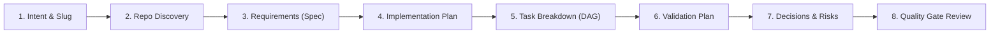

# Agentic Feature Planning DevKit

> **Autonomous, repository-aware feature planning for AI coding agents.**  
> Go from a feature idea to a validated, executable implementation **Blueprint** before writing a single line of code.

[]()
[]()
[]()
[]()
[]()

---

## 💡 What is the DevKit?

When developers ask an AI coding assistant (like Antigravity, Claude Code, or Cursor) to build a complex feature, the agent usually jumps straight into writing code. 

This often leads to:
- **Hallucinated file paths** that don't match the existing repository structure.
- **Broken conventions** (ignoring existing linting, typing, or architecture patterns).
- **Fragile implementations** where edge cases and testing requirements are forgotten.
- **Wasted developer time** cleaning up messy code diffs.

The **Agentic Feature Planning DevKit** solves this by adding an autonomous **planning step** before coding begins. The agent inspects your codebase (strictly read-only), extracts existing architectural patterns, and generates a structured, verified **Blueprint** directly inside your project under `.devkit/plans/`.

---

## 🚀 Why Use It? (Benefits for Development)

| Benefit | How It Works |
| :--- | :--- |
| 🛡️ **Zero Source Code Mutation** | Planning is strictly read-only. The DevKit will **never** alter, edit, or break your application source code or tests during the planning phase. |
| 🧭 **100% Repository-Grounded** | File paths, test patterns, framework choices, and naming conventions are extracted directly from your repository files—not generic training assumptions. |
| 🔗 **Complete Traceability** | Every User Story links directly to Functional Requirements (`FR-xxx`), atomic tasks (`TASK-xxx`), and test cases (`TC-xxx`). No orphaned requirements. |
| ⏸️ **Resumable & Crash-Proof** | Intermediate checkpoints are written to `.devkit/run-state/`. If an agent session disconnects or times out, planning can resume right where it stopped without restarting. |
| 🌐 **Universal Portability** | The core intelligence (`core/`) consists of 100% portable Markdown instructions, templates, and schemas. Zero proprietary vendor lock-in. |

---

## 🏗️ Multi-Harness Architecture

```
Agentic-Feature-Planning-DevKit/
├── core/                  <-- 100% PORTABLE CORE (Markdown orchestrator, stages, schemas, rubrics)
│                              Runs on ANY LLM agentic tool via instruction injection.
└── adapters/
    ├── antigravity/       <-- NATIVE MVP RUNTIME (Plug-and-play skill with auto-discovery)
    └── generic_contract.md<-- Standard interface for future harness native plugins
```

- **Google Antigravity (Native MVP):** Fully supported with native skill discovery via `.agents/skills/feature-planner/SKILL.md`. Simply talk to your agent in natural language.
- **Claude Code, Cursor, Windsurf, Copilot:** Fully compatible today! Point your assistant to `core/orchestrator.md` to run the identical planning workflow.

---

## ⚡ Quickstart: How to Use It in 3 Easy Steps

### Step 1: Add the DevKit to your target project

You can install the DevKit into any project in seconds:

#### Option A: Git Submodule (Recommended for Teams)
Keep the DevKit pinned inside your project repository so your entire team gets planning capabilities:
```bash
# In your target application repository root:
git submodule add https://github.com/AdityaGahukar/Agentic-Feature-Planning-DevKit.git .agents/skills/feature-planner
```

#### Option B: One-Line Installer Script
Run the automated installer to place the skill into your project:
```bash
# In your target application repository root:
curl -fsSL https://raw.githubusercontent.com/AdityaGahukar/Agentic-Feature-Planning-DevKit/main/install.sh | bash
```

#### Option C: Local Copy
If you already have this repository cloned locally on your machine:
```bash
mkdir -p /path/to/my-project/.agents/skills/feature-planner
cp -r adapters/antigravity/* /path/to/my-project/.agents/skills/feature-planner/
cp -r core /path/to/my-project/.agents/skills/feature-planner/
```

---

### Step 2: Ask the agent to plan a feature

#### In Google Antigravity (Native Skill Experience)
Open your project in Antigravity or launch the CLI:
```bash
cd /path/to/my-project
agy
```
Ask the agent in natural chat:
```text
Plan feature: Add rate limiting to the authentication endpoint to prevent brute-force attacks.
```
*Antigravity automatically detects the skill, scans your repository structure, runs the 8-stage pipeline, and presents the completed plan.*

#### In Claude Code, Cursor, or Windsurf (Instruction Injection)
Open your project in your tool of choice and prompt the agent:
```markdown
Act as an autonomous Feature Planner. Follow the instructions in:
.agents/skills/feature-planner/core/orchestrator.md

Target Repository: Current directory
Feature Statement: "Add rate limiting to the authentication endpoint to prevent brute-force attacks."

Safety Constraint: Planning is strictly read-only. Write all outputs into .devkit/.
```

---

### Step 3: Review the Blueprint & Implement

All planning artifacts are generated automatically inside `.devkit/plans/<feature-slug>/`:

```text
my-project/
├── src/                    <-- Untouched (0 modifications)
├── tests/                  <-- Untouched (0 modifications)
└── .devkit/                <-- Generated by DevKit
    └── plans/
        └── auth-rate-limiting/
            ├── feature-spec.md         # Requirements, user stories, and acceptance criteria
            ├── implementation-plan.md  # Grounded file modifications & architectural approach
            ├── task-breakdown.md       # Phased atomic tasks (TASK-001...) with dependency DAG
            ├── validation-plan.md      # Test specifications (TC-001...) mapped to ACs
            ├── decisions.md            # Architecture decision records (ADRs) & trade-offs
            └── run-summary.md          # Quality Gate validation audit
```

#### Executing the Plan:
Once you review the plan, ask your AI coding assistant to implement it task-by-task:
```text
"Review .devkit/plans/auth-rate-limiting/task-breakdown.md. 
Please implement Phase 1, TASK-001."
```
Because the agent now has exact file paths, explicit acceptance criteria, and predefined test cases, implementation is dramatically faster and avoids breaking existing code.

---

## 📁 Git Workflow & Recommendations

Add `.devkit/` rules to your project's `.gitignore` depending on your preference:

### Choice A: Team Planning (Recommended)
Keep generated feature plans in version control for team code reviews, while ignoring temporary session state:
```gitignore
# Save feature blueprints in git, ignore temporary run-state
.devkit/run-state/
```

### Choice B: Personal / Scratchpad
If you only want personal plans and don't want `.devkit/` tracked in git:
```gitignore
# Ignore all DevKit plans and temporary state
.devkit/
```

---

## 🔄 The 8-Stage Planning Pipeline

The DevKit executes an autonomous 8-stage pipeline governed by quality gates:



1. **Stage 1 (Intent Extraction & Slug Generation):** Normalizes feature statements, checks existing plans, and resolves collisions.
2. **Stage 2 (Repository Discovery & Archetype Classification):** Inspects repo structure, manifests, test runners, and classifies archetype (Application, Library, Data, Infra, Monorepo).
3. **Stage 3 (Requirements & Acceptance Criteria):** Produces testable acceptance criteria (`AC-xxx`) and clarifies critical ambiguities.
4. **Stage 4 (Architecture & Implementation Plan):** Identifies exact grounded file touchpoints (`CREATE`, `MODIFY`, `DELETE`) with zero hallucinated paths.
5. **Stage 5 (Task Breakdown & DAG):** Decomposes work into atomic tasks (`TASK-xxx`) with strict cycle-free dependency ordering.
6. **Stage 6 (Validation Plan):** Maps test specifications (`TC-xxx`) 1:1 against acceptance criteria.
7. **Stage 7 (Architectural Decisions & Risks):** Formulates structured ADRs (`ADR-xxx`) and risk mitigation strategies.
8. **Stage 8 (Quality Gate Audit & Presentation):** Runs automated quality gates (QG-1 through QG-6) and presents a concise developer summary.

---

## 📚 Documentation & Specifications

For deep dives into design, architecture, and specifications:

- 📖 **[5-Minute Quickstart (`docs/QUICKSTART.md`)](./docs/QUICKSTART.md):** Fast-track onboarding guide.
- 📘 **[Comprehensive User Guide (`docs/USER_GUIDE.md`)](./docs/USER_GUIDE.md):** Full operational manual covering advanced workflows, recovery, and configuration.
- 🖥️ **[Interactive Visual Presentation (`docs/devkit_overview.html`)](./docs/devkit_overview.html):** Responsive HTML presentation with live Mermaid diagrams for team onboarding.
- 📐 **[Visual Diagrams Directory (`docs/diagrams/`)](./docs/diagrams/):** Standalone Mermaid source diagrams for user flow, system architecture, sequence, and data flow.
- 📋 **[Functional Specification (`specs/agentic_feature_planning_devkit_spec.md`)](./specs/agentic_feature_planning_devkit_spec.md):** Complete formal specifications and acceptance criteria.
- 🏛️ **[High-Level Design (`design/agentic_feature_planning_devkit_hld.md`)](./design/agentic_feature_planning_devkit_hld.md):** System architecture and design principles.
- ⚙️ **[Low-Level Design (`design/agentic_feature_planning_devkit_lld.md`)](./design/agentic_feature_planning_devkit_lld.md):** Detailed algorithms (1, 2, 3), schemas, and data structures.
- ✅ **[MVP Verification Report (`docs/mvp_verification_report.md`)](./docs/mvp_verification_report.md):** Comprehensive test sign-off verifying 100% compliance across all requirements.

---

## 🧪 Testing & Verification

The DevKit includes a deterministic test suite covering unit tests, multi-archetype integration tests, session recovery tests, and non-mutation safety tests:

```bash
# Run the entire test suite
python3 -m unittest discover -s tests -p "test_*.py" -v
```

```text
Ran 29 tests in 0.058s

OK
```

---

## 📄 License

This project is licensed under the Apache 2.0 License. See [LICENSE](./LICENSE) for details.
