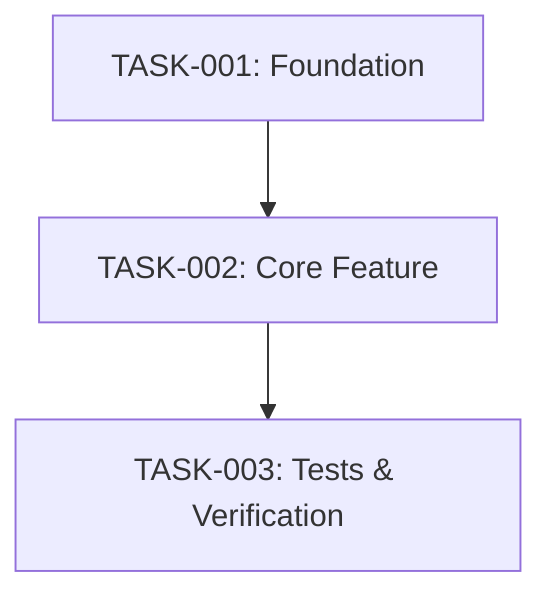

# Task Breakdown: {{feature_name}}

## Overview
- **Total Tasks:** {{total_task_count}}
- **Phases:** {{phase_count}}
- **Aggregate Complexity:** {{aggregate_complexity}}
- **Branch Strategy:** `feature/{{feature_slug}}`
- **Commit Strategy:** One atomic commit per task or per phase

## Phase 1: Foundation & Data Models

### TASK-001: {{task_title}}
- **Type:** infrastructure | feature | test | documentation
- **Complexity:** S | M | L | XL
- **Requirements:** FR-001
- **Depends on:** none
- **Target Files:**
  - Modify: `{{existing_file_path}}`
  - Create: `[NEW FILE: {{new_file_path}}]`
- **Description:**
  {{detailed_instructions_for_executor}}
- **Verification:**
  - [ ] {{task_verification_criterion_1}}
  - [ ] {{task_verification_criterion_2}}
- **Notes / Pitfalls:**
  {{optional_pitfalls}}

## Phase 2: Business Logic & API Layer

### TASK-002: {{task_title}}
- **Type:** feature
- **Complexity:** S | M | L | XL
- **Requirements:** FR-001, FR-002
- **Depends on:** TASK-001
- **Target Files:**
  - Modify: `{{existing_file_path_2}}`
  - Create: `[NEW FILE: {{new_file_path_2}}]`
- **Description:**
  {{detailed_instructions_for_executor}}
- **Verification:**
  - [ ] {{task_verification_criterion_1}}
- **Notes / Pitfalls:**
  {{optional_pitfalls}}

## Phase 3: Integration & Test Coverage

### TASK-003: {{task_title}}
- **Type:** test
- **Complexity:** S | M | L | XL
- **Requirements:** FR-001, FR-002
- **Depends on:** TASK-002
- **Target Files:**
  - Create: `[NEW FILE: {{new_test_file_path}}]`
- **Description:**
  {{detailed_instructions_for_executor}}
- **Verification:**
  - [ ] {{test_verification_criterion}}

## Task Dependency Graph

## Related Artifacts
- [Feature Specification](./feature-spec.md)
- [Implementation Plan](./implementation-plan.md)
- [Validation Plan](./validation-plan.md)
