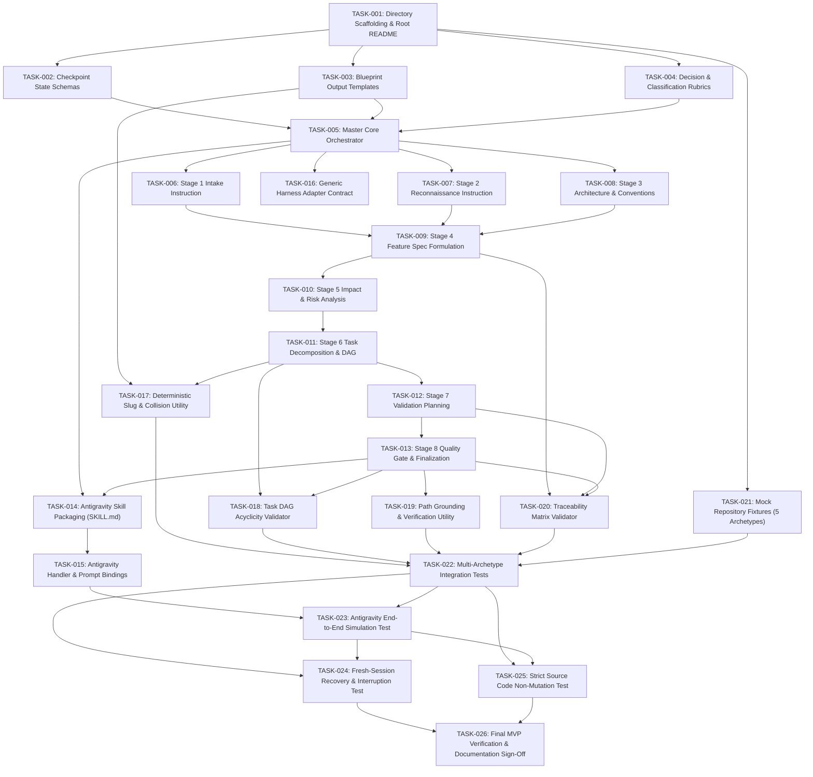

# Agentic Feature Planning DevKit — Implementation Plan

> **Document Version:** 1.0.0  
> **Status:** Ready for Execution  
> **Traceability Target:**  
> - `specs/agentic_feature_planning_devkit_spec.md` (v0.2.0)  
> - `design/agentic_feature_planning_devkit_hld.md` (v1.0.0)  
> - `design/agentic_feature_planning_devkit_lld.md` (v1.0.0)  
> **Author:** Antigravity AI + Engineering Team  
> **Date:** 2026-11-04  

---

## Table of Contents

1. [Executive Summary & Implementation Roadmap](#1-executive-summary--implementation-roadmap)
2. [Phase Breakdown & Execution Schedule](#2-phase-breakdown--execution-schedule)
3. [Master Task Dependency Graph (DAG)](#3-master-task-dependency-graph-dag)
4. [Phase 1: Foundation, Schemas, Templates & Rubrics](#4-phase-1-foundation-schemas-templates--rubrics)
5. [Phase 2: Portable Core Planning Engine](#5-phase-2-portable-core-planning-engine)
6. [Phase 3: Harness Adapters (Antigravity & Generic)](#6-phase-3-harness-adapters-antigravity--generic)
7. [Phase 4: Deterministic Quality Gate Utilities & Unit Tests](#7-phase-4-deterministic-quality-gate-utilities--unit-tests)
8. [Phase 5: Multi-Archetype Fixtures & Integration Tests](#8-phase-5-multi-archetype-fixtures--integration-tests)
9. [Phase 6: End-to-End Validation, Recovery & Safety Sign-Off](#9-phase-6-end-to-end-validation-recovery--safety-sign-off)
10. [Verification Gates & Quality Checkpoints](#10-verification-gates--quality-checkpoints)
11. [Risk Management & Mitigation Strategy](#11-risk-management--mitigation-strategy)
12. [Recommended Execution Sequence & First Step](#12-recommended-execution-sequence--first-step)

---

## 1. Executive Summary & Implementation Roadmap

This document outlines the phased, task-level implementation plan for the **Agentic Feature Planning DevKit**. The implementation translates the approved Low-Level Design (`design/agentic_feature_planning_devkit_lld.md`) into 26 atomic, dependency-ordered engineering tasks across 6 distinct phases.

### Core Implementation Principles
1. **Zero External Runtime Prerequisites:** No CLI binary, database, or background service is built. The engine consists of portable Markdown instructions, structured schemas, deterministic validation utilities, and an Antigravity skill adapter.
2. **Strict Layer Decoupling:** Core planning instructions (`core/`) are built and verified completely independent of Antigravity or any proprietary agent runtime.
3. **Traceability by Construction:** Every template, schema, and instruction incorporates strict bidirectional traceability tags (`FR-xxx`, `AC-xxx`, `TASK-xxx`, `TC-xxx`, `ADR-xxx`, `AS-xxx`, `OQ-xxx`).
4. **Sandboxed Non-Mutation:** Planning operations write exclusively to `<repo-root>/.devkit/`. Application source code and existing tests are strictly protected against modification.

---

## 2. Phase Breakdown & Execution Schedule

```
┌─────────────────────────────────────────────────────────────────────────────┐
│                       IMPLEMENTATION PHASES TIMELINE                        │
├─────────┬─────────────────────────────────────────────────┬─────────────────┤
│ Phase   │ Description                                     │ Deliverables    │
├─────────┼─────────────────────────────────────────────────┼─────────────────┤
│ Phase 1 │ Foundation, Schemas, Templates & Rubrics        │ 16 files        │
│         │ Directory structure, checkpoint schemas,        │ Tasks 001–004   │
│         │ Blueprint templates, classification rubrics.    │                 │
├─────────┼─────────────────────────────────────────────────┼─────────────────┤
│ Phase 2 │ Portable Core Planning Engine                   │ 9 files         │
│         │ Master orchestrator and 8 stage instructions.   │ Tasks 005–013   │
├─────────┼─────────────────────────────────────────────────┼─────────────────┤
│ Phase 3 │ Harness Adapters (Antigravity & Generic)        │ 3 files         │
│         │ Antigravity SKILL.md, handler, generic contract.│ Tasks 014–016   │
├─────────┼─────────────────────────────────────────────────┼─────────────────┤
│ Phase 4 │ Deterministic Quality Gate Utilities & Unit Tests│ 6 files        │
│         │ Slug generator, DAG validator, path grounding,  │ Tasks 017–020   │
│         │ traceability checker, unit test runner.         │                 │
├─────────┼─────────────────────────────────────────────────┼─────────────────┤
│ Phase 5 │ Multi-Archetype Fixtures & Integration Tests    │ 5 fixture trees │
│         │ App, Library, Data Eng, Infra, Monorepo fixtures│ Tasks 021–023   │
│         │ and simulated planning runners.                 │                 │
├─────────┼─────────────────────────────────────────────────┼─────────────────┤
│ Phase 6 │ E2E Validation, Recovery & Safety Sign-Off      │ 3 test suites   │
│         │ Fresh-session recovery test, non-mutation test, │ Tasks 024–026   │
│         │ full MVP verification report.                   │                 │
└─────────┴─────────────────────────────────────────────────┴─────────────────┘
```

---

## 3. Master Task Dependency Graph (DAG)



---

## 4. Phase 1: Foundation, Schemas, Templates & Rubrics

### TASK-001: Directory Scaffolding & Root Documentation
- **Objective:** Establish the clean project directory tree and foundational documentation.
- **Implementation Details:**
  - Create directories: `core/stages/`, `core/rubrics/`, `core/templates/`, `core/schemas/`, `adapters/antigravity/`, `tests/fixtures/`, `tests/unit/`, `tests/integration/`.
  - Create root `README.md` with project vision, architecture summary, and link to spec and designs.
- **Files to Create:**
  - `README.md`
  - `.gitignore` (ignoring `.devkit/run-state/`, `__pycache__/`, `*.pyc`, `.DS_Store`)
- **Dependencies:** None.
- **Acceptance Criteria:**
  - [ ] All specified directories exist on disk.
  - [ ] Root `README.md` references approved spec v0.2.0 and HLD/LLD v1.0.0.
  - [ ] `.gitignore` contains rules for temporary run-state.
- **Validation:** `ls -la` and directory existence verification.
- **Expected Deliverable:** Scaffolded repository structure with `README.md`.

---

### TASK-002: Checkpoint State Schemas
- **Objective:** Create the strict Markdown schemas for temporary run-state files (`.devkit/run-state/`).
- **Implementation Details:**
  - Define schemas for `intake.md`, `repo-map.md`, `repo-type.md`, `architecture.md`, `conventions.md`, and `stage-log.md`.
  - Include front-matter schemas with `run_id`, `feature_slug`, `feature_statement_hash`, and stage lifecycle statuses.
- **Files to Create:**
  - `core/schemas/intake_state_schema.md`
  - `core/schemas/repo_map_schema.md`
  - `core/schemas/repo_type_schema.md`
  - `core/schemas/architecture_schema.md`
  - `core/schemas/conventions_schema.md`
  - `core/schemas/stage_log_schema.md`
- **Dependencies:** TASK-001.
- **Acceptance Criteria:**
  - [ ] All 6 schema files define mandatory headers, front-matter fields, and section requirements.
  - [ ] `stage_log_schema.md` defines state enum: `PENDING`, `IN_PROGRESS`, `COMPLETED`, `FAILED`, `SKIPPED`.
- **Validation:** Manual inspection against LLD Section 7 and 10.
- **Expected Deliverable:** 6 complete checkpoint state schemas.

---

### TASK-003: Blueprint Output Templates
- **Objective:** Create the canonical production templates for all 7 Blueprint deliverables.
- **Implementation Details:**
  - Implement full templates with YAML front-matter, placeholders (`{{...}}`), section headers, and traceability anchors.
- **Files to Create:**
  - `core/templates/feature_spec_template.md`
  - `core/templates/implementation_plan_template.md`
  - `core/templates/task_breakdown_template.md` (including Mermaid flowchart skeleton)
  - `core/templates/validation_plan_template.md`
  - `core/templates/decisions_template.md`
  - `core/templates/run_summary_template.md`
  - `core/templates/plan_run_log_template.md`
- **Dependencies:** TASK-001.
- **Acceptance Criteria:**
  - [ ] All 7 templates match LLD Section 6 verbatim.
  - [ ] Every template includes version `0.2.0`, standard front-matter fields, and relative cross-links.
- **Validation:** Text comparison against LLD Section 6 definitions.
- **Expected Deliverable:** 7 canonical Blueprint output templates.

---

### TASK-004: Decision & Classification Rubrics
- **Objective:** Formalize the 4-tier Evidence Rubric and Repository Classification Matrix into reusable core references.
- **Implementation Details:**
  - `evidence_rubric.md`: Operationalize tiers (*Evidence-Supported*, *Reasonable Assumption*, *Design Choice*, *Critical Ambiguity*) with human intervention constraints (max 1 pause, max 5 questions).
  - `repo_classification_matrix.md`: Operationalize scoring heuristics for App, Library, Data Eng, Infra, Monorepo, Unknown.
- **Files to Create:**
  - `core/rubrics/evidence_rubric.md`
  - `core/rubrics/repo_classification_matrix.md`
- **Dependencies:** TASK-001.
- **Acceptance Criteria:**
  - [ ] Zero numeric probability scores (e.g. "70%") used; purely evidence-driven.
  - [ ] Classification scoring weights match LLD Section 4.1.
- **Validation:** Review against LLD Section 4 & Section 9.
- **Expected Deliverable:** 2 formal rubric instruction files.

---

## 5. Phase 2: Portable Core Planning Engine

### TASK-005: Master Core Orchestrator
- **Objective:** Write the central execution algorithm (`core/orchestrator.md`) driving the single-agent 8-stage pipeline.
- **Implementation Details:**
  - Encode Algorithm 1 from LLD Section 3.1.
  - Detail stage transition rules, error handling, checkpoint writing, and stage logging.
  - Integrate fresh-session resumption checks (Algorithm 3) before Stage 1.
- **Files to Create:**
  - `core/orchestrator.md`
- **Dependencies:** TASK-002, TASK-003, TASK-004.
- **Acceptance Criteria:**
  - [ ] Fully specifies single-agent autonomous execution across Stages 1–8.
  - [ ] Contains zero Antigravity-specific tool names (uses abstract file read/write directives).
  - [ ] Contains strict sandboxing instructions (only write inside `.devkit/`).
- **Validation:** Walkthrough against LLD Section 3.
- **Expected Deliverable:** Complete master orchestrator specification.

---

### TASK-006: Stage 1 Intake & Clarification Instruction
- **Objective:** Author detailed agent instructions for Stage 1 (Intake, Slug computation, Critical Ambiguity evaluation).
- **Implementation Details:**
  - Specify input parameter validation, slug derivation rules (6–8 words, lowercase, kebab-case, collision suffixing).
  - Instruct agent on Critical Ambiguity filtering using `core/rubrics/evidence_rubric.md`.
  - Detail batched Q&A pause format and writing `.devkit/run-state/intake.md`.
- **Files to Create:**
  - `core/stages/stage1_intake.md`
- **Dependencies:** TASK-005.
- **Acceptance Criteria:**
  - [ ] Covers slug generation, collision detection, and depth evaluation.
  - [ ] Enforces maximum 1 Q&A pause with maximum 5 batched questions.
  - [ ] Mandates writing `intake.md` per schema before proceeding.
- **Validation:** Review against LLD Section 3.2 (Stage 1).
- **Expected Deliverable:** `stage1_intake.md`.

---

### TASK-007: Stage 2 Repository Reconnaissance Instruction
- **Objective:** Author instructions for Stage 2 (Read-only scanning, Manifest analysis, Archetype detection).
- **Implementation Details:**
  - Guide agent through the 4-pass scanning routine (LLD Section 4.2).
  - Instruct calculation of archetype points using `repo_classification_matrix.md`.
  - Mandate writing `.devkit/run-state/repo-map.md` and `repo-type.md`.
- **Files to Create:**
  - `core/stages/stage2_recon.md`
- **Dependencies:** TASK-005.
- **Acceptance Criteria:**
  - [ ] Strictly forbids fabricating file paths.
  - [ ] Limits deep inspection to max 50 relevant files to conserve context.
  - [ ] Writes `repo-map.md` and `repo-type.md` matching schemas.
- **Validation:** Review against LLD Section 4.
- **Expected Deliverable:** `stage2_recon.md`.

---

### TASK-008: Stage 3 Architecture & Conventions Instruction
- **Objective:** Author instructions for Stage 3 (Pattern inference, Module boundary mapping, 7-dimension convention extraction).
- **Implementation Details:**
  - Implement Algorithm 2 (Empirical Convention Extraction across file naming, directory layout, imports, errors, logging, testing, APIs).
  - Enforce the **Convention Precedence Rule** (Repository code overrides external framework defaults).
  - Mandate writing `architecture.md` and `conventions.md`.
- **Files to Create:**
  - `core/stages/stage3_architecture.md`
- **Dependencies:** TASK-005.
- **Acceptance Criteria:**
  - [ ] Tags all architectural patterns as `[INFERRED]`.
  - [ ] Enforces empirical extraction with code samples as evidence.
  - [ ] Documents all framework convention deviations as `[ASSUMPTION: evidence-supported]`.
- **Validation:** Review against LLD Section 5.
- **Expected Deliverable:** `stage3_architecture.md`.

---

### TASK-009: Stage 4 Feature Specification Instruction
- **Objective:** Author instructions for Stage 4 (Synthesizing User Stories, FRs, ACs, and scope boundaries).
- **Implementation Details:**
  - Instruct agent to parse feature intent and repo constraints into structured `US-xxx`, `FR-xxx`, and testable `AC-xxx` items.
  - Mandate population of `core/templates/feature_spec_template.md`.
  - Write output directly to `.devkit/plans/<slug>/feature-spec.md`.
- **Files to Create:**
  - `core/stages/stage4_spec.md`
- **Dependencies:** TASK-006, TASK-007, TASK-008.
- **Acceptance Criteria:**
  - [ ] Every FR must have at least one testable, binary-pass AC.
  - [ ] All assumptions categorized per Evidence Rubric tiers.
  - [ ] Output saved to `.devkit/plans/<slug>/feature-spec.md`.
- **Validation:** Review against LLD Section 6.1.
- **Expected Deliverable:** `stage4_spec.md`.

---

### TASK-010: Stage 5 Impact & Risk Analysis Instruction
- **Objective:** Author instructions for Stage 5 (Blast radius, backward compatibility, security, migration, and risk register).
- **Implementation Details:**
  - Instruct identification of exact file modification targets and new files (`[NEW FILE]`).
  - Instruct evaluation of security boundaries and data migrations.
  - Construct Risk Register with likelihood, impact, and mitigations.
- **Files to Create:**
  - `core/stages/stage5_impact_risk.md`
- **Dependencies:** TASK-009.
- **Acceptance Criteria:**
  - [ ] Generates impact analysis separating existing files from `[NEW FILE]`.
  - [ ] Includes Risk Register populated with at least one technical risk and mitigation.
- **Validation:** Review against LLD Section 6.5.
- **Expected Deliverable:** `stage5_impact_risk.md`.

---

### TASK-011: Stage 6 Task Decomposition & DAG Instruction
- **Objective:** Author instructions for Stage 6 (Decomposing into phased atomic tasks, verifying paths, generating Mermaid DAG).
- **Implementation Details:**
  - Instruct atomic task formulation (`TASK-xxx`) with metadata: Type, Complexity (S/M/L/XL), Requirements (`FR-xxx`), Dependencies, Target Files, Instructions, Verification.
  - Enforce Path Grounding: Every file must exist in `repo-map.md` or be tagged `[NEW FILE: <path>]`.
  - Generate Mermaid flowchart DAG.
  - Write `task-breakdown.md` and `implementation-plan.md` using templates.
- **Files to Create:**
  - `core/stages/stage6_tasks.md`
- **Dependencies:** TASK-010.
- **Acceptance Criteria:**
  - [ ] Produces ordered, phased tasks with zero circular dependencies.
  - [ ] Includes valid Mermaid DAG flowchart.
  - [ ] Populates `task-breakdown.md` and `implementation-plan.md`.
- **Validation:** Review against LLD Section 6.2.
- **Expected Deliverable:** `stage6_tasks.md`.

---

### TASK-012: Stage 7 Validation Planning Instruction
- **Objective:** Author instructions for Stage 7 (Mapping ACs to test cases, fixture specifications, manual procedures).
- **Implementation Details:**
  - Map 100% of `AC-xxx` items to explicit `TC-xxx` test specifications.
  - Align test runner and file paths with detected test framework from Stage 2.
  - Detail preconditions, test steps, expected outcomes, and mocks.
  - Write `.devkit/plans/<slug>/validation-plan.md` using template.
- **Files to Create:**
  - `core/stages/stage7_validation.md`
- **Dependencies:** TASK-011.
- **Acceptance Criteria:**
  - [ ] 100% coverage of Acceptance Criteria in test case specifications.
  - [ ] Specifies target test files and runner commands aligned with repo.
- **Validation:** Review against LLD Section 6.3.
- **Expected Deliverable:** `stage7_validation.md`.

---

### TASK-013: Stage 8 Quality Gate & Finalization Instruction
- **Objective:** Author instructions for Stage 8 (Executing verification gates QG-H1..QG-H5 and QG-S1..QG-S4, writing Blueprints, safe cleanup).
- **Implementation Details:**
  - Detail step-by-step agent execution of Hard Gates: path grounding, acyclic DAG (Kahn's algorithm), FR-to-TASK coverage, AC-to-TC coverage, zero source code modification.
  - Write `decisions.md` (ADRs + Assumptions + Open Questions).
  - Write `run-summary.md` with gate results table.
  - Promote `stage-log.md` to `plan-run.log`.
  - Purge temporary `.devkit/run-state/` files.
- **Files to Create:**
  - `core/stages/stage8_quality_gate.md`
- **Dependencies:** TASK-012.
- **Acceptance Criteria:**
  - [ ] Fully specifies gate evaluation logic and status determination (`approved`, `draft`, `incomplete`).
  - [ ] Enforces consolidation of `plan-run.log` and cleanup of `.devkit/run-state/`.
- **Validation:** Review against LLD Section 8.
- **Expected Deliverable:** `stage8_quality_gate.md`.

---

## 6. Phase 3: Harness Adapters (Antigravity & Generic)

### TASK-014: Antigravity Skill Declaration (`SKILL.md`)
- **Objective:** Package the portable DevKit core as a native Antigravity skill.
- **Implementation Details:**
  - Create `adapters/antigravity/SKILL.md` with YAML front-matter (`name: feature-planner`, description, parameters, tools: `read_file`, `write_file`, `run_command`).
  - Provide clear prompt instructions directing the agent to invoke `core/orchestrator.md`.
- **Files to Create:**
  - `adapters/antigravity/SKILL.md`
- **Dependencies:** TASK-005, TASK-013.
- **Acceptance Criteria:**
  - [ ] Conforms to Antigravity skill specification format.
  - [ ] Declares only standard read/write/shell tools.
  - [ ] Forbids writing outside `.devkit/`.
- **Validation:** Skill format inspection against Antigravity skill guide.
- **Expected Deliverable:** `adapters/antigravity/SKILL.md`.

---

### TASK-015: Antigravity Handler & Chat Presentation
- **Objective:** Create execution guidelines for parameter extraction, Q&A relay, and completion summary presentation.
- **Implementation Details:**
  - Document parameter mapping from chat intents into canonical arguments (`repo`, `feature`, `stack`, `depth`).
  - Define interactive relay format for Critical Ambiguity questions.
  - Format completion message delivering clickable file links (`file://...`) to generated Blueprint artifacts.
- **Files to Create:**
  - `adapters/antigravity/handler.md`
- **Dependencies:** TASK-014.
- **Acceptance Criteria:**
  - [ ] Details single batched Q&A pause presentation in chat.
  - [ ] Formats final summary with relative and clickable file links.
- **Validation:** Review against LLD Section 9.
- **Expected Deliverable:** `adapters/antigravity/handler.md`.

---

### TASK-016: Generic Harness Adapter Contract
- **Objective:** Formalize the minimal adapter contract for future runtimes (Cursor, Claude Code, GitHub Copilot).
- **Implementation Details:**
  - Document the 4 primitive capabilities required: workspace access, instruction injection, human clarification relay, and tool independence.
  - Provide an example configuration for headless or non-Antigravity agents.
- **Files to Create:**
  - `adapters/generic_contract.md`
- **Dependencies:** TASK-005.
- **Acceptance Criteria:**
  - [ ] Confirms core is 100% executable by any LLM harness with basic file tools.
  - [ ] Contains zero vendor-specific proprietary requirements.
- **Validation:** Review against LLD Section 10.
- **Expected Deliverable:** `adapters/generic_contract.md`.

---

## 7. Phase 4: Deterministic Quality Gate Utilities & Unit Tests

### TASK-017: Deterministic Slug & Collision Utility
- **Objective:** Implement and test the slug generation and collision detection logic in Python for automated verification.
- **Implementation Details:**
  - Implement `slug_generator.py`: stop-word removal, lowercase, hyphenation, 60-character truncation, `-2`, `-3` directory collision checking.
  - Create unit tests verifying edge cases: punctuation, long sentences, existing directories.
- **Files to Create:**
  - `tests/unit/slug_generator.py`
  - `tests/unit/test_slug_generator.py`
- **Dependencies:** TASK-003, TASK-011.
- **Acceptance Criteria:**
  - [ ] Generates clean URL-safe slugs ≤ 60 chars.
  - [ ] Detects directory collisions and suffixes `-2`, `-3` reliably.
  - [ ] 100% pass on unit tests.
- **Validation:** `pytest tests/unit/test_slug_generator.py` (or Python unittest).
- **Expected Deliverable:** Working slug utility and unit test suite.

---

### TASK-018: Task DAG Acyclicity Validator
- **Objective:** Implement Kahn's algorithm cycle detector in Python to validate Mermaid DAGs and task dependencies.
- **Implementation Details:**
  - Implement `dag_validator.py`: parse `task-breakdown.md` tasks and "Depends on:" fields into an adjacency list; execute Kahn's topological sort.
  - Create unit tests with valid acyclic graphs and known cyclic graphs (detecting cycle).
- **Files to Create:**
  - `tests/unit/dag_validator.py`
  - `tests/unit/test_dag_validation.py`
- **Dependencies:** TASK-011, TASK-013.
- **Acceptance Criteria:**
  - [ ] Correctly identifies acyclic graphs and returns topological order.
  - [ ] Detects single-edge and multi-edge circular cycles and returns failing node IDs.
  - [ ] 100% pass on unit tests.
- **Validation:** `pytest tests/unit/test_dag_validation.py`.
- **Expected Deliverable:** DAG validator utility and unit test suite.

---

### TASK-019: Path Grounding & Verification Utility
- **Objective:** Implement path grounding verification checking task targets against disk inventory.
- **Implementation Details:**
  - Implement `path_grounding.py`: regex extraction of "Modify: `path`" and "Create: `[NEW FILE: path]`" from `task-breakdown.md`; checks disk existence.
  - Create unit tests for valid existing paths, valid new paths, hallucinated paths (flagged), and existing files wrongly marked new (flagged).
- **Files to Create:**
  - `tests/unit/path_grounding.py`
  - `tests/unit/test_path_grounding.py`
- **Dependencies:** TASK-013.
- **Acceptance Criteria:**
  - [ ] Flags ungrounded paths as Hard Gate failures.
  - [ ] Validates `[NEW FILE]` syntax and verifies target does not already exist.
  - [ ] 100% pass on unit tests.
- **Validation:** `pytest tests/unit/test_path_grounding.py`.
- **Expected Deliverable:** Path grounding utility and unit test suite.

---

### TASK-020: Traceability Matrix Validator
- **Objective:** Implement bidirectional traceability validator checking FR ↔ TASK and AC ↔ TC mapping.
- **Implementation Details:**
  - Implement `traceability_validator.py`: extracts all `FR-xxx` and `AC-xxx` from `feature-spec.md`; verifies mapping in `task-breakdown.md` and `validation-plan.md`.
  - Create unit tests with 100% mapped plans and intentionally broken plans (detecting unmapped requirements).
- **Files to Create:**
  - `tests/unit/traceability_validator.py`
  - `tests/unit/test_traceability_matrix.py`
- **Dependencies:** TASK-009, TASK-012, TASK-013.
- **Acceptance Criteria:**
  - [ ] Confirms bidirectional mapping without false positives.
  - [ ] Flags unmapped FRs or untested ACs with exact missing IDs.
  - [ ] 100% pass on unit tests.
- **Validation:** `pytest tests/unit/test_traceability_matrix.py`.
- **Expected Deliverable:** Traceability matrix validator and unit test suite.

---

## 8. Phase 5: Multi-Archetype Fixtures & Integration Tests

### TASK-021: Mock Repository Fixtures (5 Archetypes)
- **Objective:** Create realistic mock repository trees representing the 5 key codebase archetypes.
- **Implementation Details:**
  - `sample_app/`: Node.js Express server + React frontend, `package.json`, routes, controllers, tests.
  - `sample_library/`: TypeScript SDK with `src/index.ts`, packaging exports, Jest unit tests, no server.
  - `sample_data_eng/`: Python ETL with Airflow DAGs, `dbt_project.yml`, pipeline scripts.
  - `sample_infra/`: Terraform (`main.tf`, `variables.tf`) + Helm charts, no app code.
  - `sample_monorepo/`: pnpm workspace with `packages/core` and `packages/api`.
- **Files to Create:**
  - Realistic mock file trees under `tests/fixtures/` (minimal code sufficient for reconnaissance).
- **Dependencies:** TASK-001.
- **Acceptance Criteria:**
  - [ ] All 5 fixtures contain appropriate manifests, configs, and directory structures.
  - [ ] Fixtures trigger correct archetype classification in `repo_classification_matrix.md`.
- **Validation:** Manifest and directory inspection.
- **Expected Deliverable:** 5 mock repository fixture directories.

---

### TASK-022: Multi-Archetype Integration Tests
- **Objective:** Build test harness simulating planning runs against the 5 mock fixtures and verifying archetype-specific outputs.
- **Implementation Details:**
  - Implement `test_e2e_app_planning.py`: runs simulated planning workflow against fixtures.
  - Verify `repo-type.md` accurately classifies each fixture.
  - Verify generated Blueprints follow the repository's observed conventions.
- **Files to Create:**
  - `tests/integration/test_e2e_app_planning.py`
  - `tests/integration/integration_runner.py`
- **Dependencies:** TASK-017, TASK-018, TASK-019, TASK-020, TASK-021.
- **Acceptance Criteria:**
  - [ ] All 5 fixtures successfully classified with expected archetype.
  - [ ] Extracted conventions reflect the mock codebases (e.g. PascalCase vs kebab-case).
  - [ ] All Hard Quality Gates pass on generated fixture plans.
- **Validation:** Run integration test suite against fixtures.
- **Expected Deliverable:** Integration test harness and multi-archetype test suite.

---

### TASK-023: Antigravity End-to-End Simulation Test
- **Objective:** Verify Antigravity adapter skill bindings and parameter translation in a simulated agent environment.
- **Implementation Details:**
  - Test `SKILL.md` invocation with mock user prompts.
  - Verify parameter parsing (`repo`, `feature`, `depth`, `stack`).
  - Verify final summary output format contains clickable links.
- **Files to Create:**
  - `tests/integration/test_antigravity_adapter.py`
- **Dependencies:** TASK-015, TASK-022.
- **Acceptance Criteria:**
  - [ ] Verifies skill parameter extraction correctly initializes orchestrator.
  - [ ] Verifies completion summary displays all generated artifact links.
- **Validation:** Run adapter simulation test.
- **Expected Deliverable:** `test_antigravity_adapter.py`.

---

## 9. Phase 6: End-to-End Validation, Recovery & Safety Sign-Off

### TASK-024: Fresh-Session Recovery & Interruption Test
- **Objective:** Verify checkpoint persistence, stale-state detection, and session recovery without conversation history.
- **Implementation Details:**
  - Implement `test_session_recovery.py`:
    1. Start a planning run on `sample_app`.
    2. Artificially terminate execution after Stage 3 (`architecture.md` written).
    3. Verify `.devkit/run-state/` contains valid checkpoints.
    4. Launch a clean, independent session (zero in-memory history).
    5. Verify session detects `stage-log.md`, reads checkpoints, and resumes at Stage 4.
    6. Verify final plan completes successfully.
    7. Test hash mismatch: attempt resuming with a different feature statement and verify old run-state is purged.
- **Files to Create:**
  - `tests/integration/test_session_recovery.py`
- **Dependencies:** TASK-022, TASK-023.
- **Acceptance Criteria:**
  - [ ] Interrupted run resumes cleanly from checkpoint without repeating Stages 1–3.
  - [ ] Unrelated feature statement triggers safe state purge without pollution.
- **Validation:** `pytest tests/integration/test_session_recovery.py`.
- **Expected Deliverable:** Fresh-session recovery test suite.

---

### TASK-025: Strict Source Code Non-Mutation Test
- **Objective:** Verify that 100% of planning operations leave target repository source files and tests untouched.
- **Implementation Details:**
  - Implement `test_non_mutation.py`:
    1. Snapshot `git status --porcelain` and SHA256 hashes of all files in target repository prior to planning.
    2. Execute full 8-stage planning run.
    3. Inspect git status and file hashes post-run.
    4. Assert that ONLY paths under `.devkit/` were created or modified.
    5. Assert that zero application files, existing tests, or configs were changed.
- **Files to Create:**
  - `tests/integration/test_non_mutation.py`
- **Dependencies:** TASK-022, TASK-023.
- **Acceptance Criteria:**
  - [ ] Exact git status assertion passes: zero changes outside `.devkit/`.
  - [ ] File checksum verification confirms 100% immutability of application code.
- **Validation:** `pytest tests/integration/test_non_mutation.py`.
- **Expected Deliverable:** Non-mutation safety test suite.

---

### TASK-026: Final MVP Verification & Documentation Sign-Off
- **Objective:** Perform final verification of all acceptance criteria (`AC-1` to `AC-10`) and compile the MVP validation report.
- **Implementation Details:**
  - Run full test suite: unit tests, integration tests, recovery tests, non-mutation tests.
  - Audit all files against approved Specification v0.2.0 and LLD v1.0.0.
  - Compile `docs/mvp_verification_report.md` recording test results, traceability status, and release readiness.
- **Files to Create:**
  - `docs/mvp_verification_report.md`
- **Dependencies:** TASK-024, TASK-025.
- **Acceptance Criteria:**
  - [ ] 100% tests passing across all test suites.
  - [ ] All 10 Specification Acceptance Criteria verified and documented.
  - [ ] Zero unhandled deviations or open architectural questions.
- **Validation:** Complete test run and documentation audit.
- **Expected Deliverable:** Final MVP verification report and sign-off.

---

## 10. Verification Gates & Quality Checkpoints

Between each implementation phase, a formal verification gate must pass before advancing:

```
┌─────────────────────────────────────────────────────────────────────────────┐
│                           PHASE VERIFICATION GATES                          │
├───────┬───────────────────────────────┬─────────────────────────────────────┤
│ Gate  │ Phase Transition              │ Verification Criteria               │
├───────┼───────────────────────────────┼─────────────────────────────────────┤
│ VG-1  │ Phase 1 ──► Phase 2           │ All 6 state schemas, 7 templates,   │
│       │                               │ and 2 rubrics exist and match LLD.  │
├───────┼───────────────────────────────┼─────────────────────────────────────┤
│ VG-2  │ Phase 2 ──► Phase 3           │ Orchestrator and all 8 stage docs   │
│       │                               │ complete; zero harness tool leakage.│
├───────┼───────────────────────────────┼─────────────────────────────────────┤
│ VG-3  │ Phase 3 ──► Phase 4           │ SKILL.md, handler, and generic      │
│       │                               │ contract valid; parameter mapping ok│
├───────┼───────────────────────────────┼─────────────────────────────────────┤
│ VG-4  │ Phase 4 ──► Phase 5           │ All 4 deterministic unit test suites│
│       │                               │ pass with 100% success rate.        │
├───────┼───────────────────────────────┼─────────────────────────────────────┤
│ VG-5  │ Phase 5 ──► Phase 6           │ 5 mock fixtures classified properly;│
│       │                               │ multi-archetype integration tests ok│
├───────┼───────────────────────────────┼─────────────────────────────────────┤
│ VG-6  │ Phase 6 ──► MVP Complete      │ Recovery test passes; 0 non-devkit  │
│       │                               │ mutations; all 10 ACs verified.     │
└───────┴───────────────────────────────┴─────────────────────────────────────┘
```

---

## 11. Risk Management & Mitigation Strategy

| Risk ID | Potential Failure Mode | Impact | Mitigation Strategy in Plan |
|---|---|---|---|
| **R-1** | Antigravity-specific syntax leaks into Core Layer. | High | Enforced in VG-2: Core instructions use abstract file operations; harness bindings isolated to `adapters/`. |
| **R-2** | Checkpoint reuse across different feature requests. | High | Task 002 & Task 024 implement `feature_statement_hash` validation in Algorithm 3. |
| **R-3** | Accidental mutation of application code during planning. | Critical | Task 013, Task 019, and Task 025 enforce path containment assertions and `git status` verification. |
| **R-4** | Task DAG contains circular dependencies. | High | Task 018 implements Kahn's algorithm cycle detection as Hard Gate `QG-H2`. |
| **R-5** | Unrealistic or hallucinated file paths in tasks. | High | Task 019 implements path grounding validator checking paths against disk inventory as Hard Gate `QG-H1`. |
| **R-6** | Reconnaissance consumes excessive context on large repos. | Medium | Task 007 enforces 4-pass scan routine capping deep file inspection at max 50 files. |

---

## 12. Recommended Execution Sequence & First Step

### Recommended Approach
Implement phases sequentially. While certain tasks within a phase can proceed in parallel (e.g. TASK-002, TASK-003, TASK-004 in Phase 1; TASK-017, TASK-018, TASK-019, TASK-020 in Phase 4), **each phase should be verified and signed off at its verification gate before beginning the subsequent phase**.

### The First Step to Execute
Begin immediately with **Phase 1, TASK-001: Directory Scaffolding & Root Documentation**.

---

*End of Implementation Plan — v1.0.0 — Ready for Execution*
