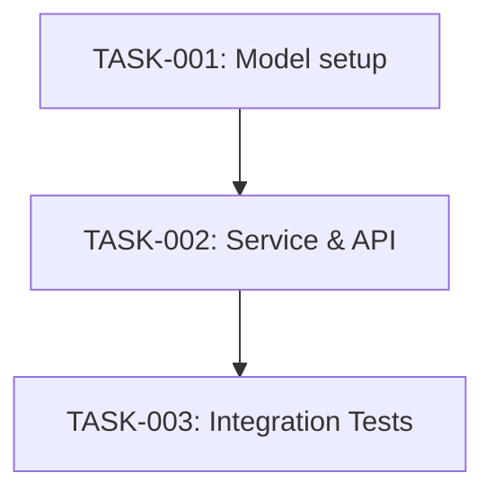

# Agentic Feature Planning DevKit — Low-Level Design (LLD)

> **Document Version:** 1.0.0  
> **Status:** Ready for Review  
> **Traceability Target:** `specs/agentic_feature_planning_devkit_spec.md` (v0.2.0) & `design/agentic_feature_planning_devkit_hld.md` (v1.0.0)  
> **Author:** Antigravity AI + Project Engineering Team  
> **Date:** 2026-11-04  

---

## Table of Contents

1. [Executive Summary & Implementation Objectives](#1-executive-summary--implementation-objectives)
2. [Target Repository Structure](#2-target-repository-structure)
3. [Core Planning Engine — Stage Contracts & Autonomous Execution](#3-core-planning-engine--stage-contracts--autonomous-execution)
4. [Repository Reconnaissance & Type Detection Engine](#4-repository-reconnaissance--type-detection-engine)
5. [Evidence-Driven Convention & Framework Resolution](#5-evidence-driven-convention--framework-resolution)
6. [Blueprint Artifact Templates & Traceability Schemas](#6-blueprint-artifact-templates--traceability-schemas)
7. [Intermediate State, Run Identity & Session Recovery](#7-intermediate-state-run-identity--session-recovery)
8. [Executable Plan Quality Gate Procedures](#8-executable-plan-quality-gate-procedures)
9. [Antigravity Harness Adapter Specification](#9-antigravity-harness-adapter-specification)
10. [Generic Harness Adapter Contract](#10-generic-harness-adapter-contract)
11. [Security, Boundaries & Safe File System Operations](#11-security-boundaries--safe-file-system-operations)
12. [Verification & Testing Strategy](#12-verification--testing-strategy)
13. [Traceability & Specification Compliance](#13-traceability--specification-compliance)

---

## 1. Executive Summary & Implementation Objectives

This Low-Level Design (LLD) provides the concrete, implementation-ready specifications for building the **Agentic Feature Planning DevKit**. It bridges the High-Level Design (`design/agentic_feature_planning_devkit_hld.md`) into granular file layouts, step-by-step algorithms, prompt instructions, artifact templates, and quality gate verification procedures.

### Core Implementation Principles
1. **Instruction-Based Engine:** The planning intelligence is encoded as deterministic, structured Markdown instructions, schemas, and rules. No compiled CLI or runtime daemon is required.
2. **Autonomous Execution:** The executing agent drives all 8 stages consecutively within a single session without developer prompting between stages.
3. **Session & Harness Independence:** The core contains zero proprietary harness syntax. Artifacts in `.devkit/plans/<slug>/` and state in `.devkit/run-state/` allow any human or agent to resume or execute without prior chat logs.
4. **Zero Source Mutation:** Every write operation is strictly bounded to `<repo-root>/.devkit/`. Application code is never modified.

---

## 2. Target Repository Structure

The DevKit repository is organized to cleanly separate the **Portable Core Layer**, the **Antigravity Adapter Layer**, **Shared Templates**, and **Test Fixtures**.

```
agentic-feature-planning-devkit/
├── README.md                                    # Project overview and quickstart guide
├── specs/
│   └── agentic_feature_planning_devkit_spec.md  # Approved functional specification v0.2.0
├── design/
│   ├── agentic_feature_planning_devkit_hld.md   # Approved High-Level Design v1.0.0
│   └── agentic_feature_planning_devkit_lld.md   # This Low-Level Design document
├── core/                                        # PORTABLE CORE LAYER (Harness-Agnostic)
│   ├── orchestrator.md                          # Master pipeline execution algorithm & loop
│   ├── stages/                                  # Detailed stage instructions
│   │   ├── stage1_intake.md                     # Stage 1: Intake & Critical Ambiguity Check
│   │   ├── stage2_recon.md                      # Stage 2: Repo Recon & Type Classification
│   │   ├── stage3_architecture.md               # Stage 3: Architecture & Convention Extraction
│   │   ├── stage4_spec.md                       # Stage 4: Feature Specification Drafting
│   │   ├── stage5_impact_risk.md                # Stage 5: Impact & Risk Assessment
│   │   ├── stage6_tasks.md                      # Stage 6: Task Decomposition & DAG Creation
│   │   ├── stage7_validation.md                 # Stage 7: Validation & Test Case Mapping
│   │   └── stage8_quality_gate.md               # Stage 8: Quality Gate & Blueprint Finalization
│   ├── rubrics/
│   │   ├── evidence_rubric.md                   # 4-tier decision classification rules
│   │   └── repo_classification_matrix.md        # Heuristics for repo archetype detection
│   ├── templates/                               # Canonical Blueprint Output Templates
│   │   ├── feature_spec_template.md             # Template for feature-spec.md
│   │   ├── implementation_plan_template.md      # Template for implementation-plan.md
│   │   ├── task_breakdown_template.md           # Template for task-breakdown.md
│   │   ├── validation_plan_template.md          # Template for validation-plan.md
│   │   ├── decisions_template.md                # Template for decisions.md
│   │   ├── run_summary_template.md              # Template for run-summary.md
│   │   └── plan_run_log_template.md             # Template for plan-run.log
│   └── schemas/                                 # Run-state checkpoint schemas
│       ├── intake_state_schema.md               # Schema for .devkit/run-state/intake.md
│       ├── repo_map_schema.md                   # Schema for .devkit/run-state/repo-map.md
│       ├── repo_type_schema.md                  # Schema for .devkit/run-state/repo-type.md
│       ├── architecture_schema.md               # Schema for .devkit/run-state/architecture.md
│       ├── conventions_schema.md                # Schema for .devkit/run-state/conventions.md
│       └── stage_log_schema.md                  # Schema for .devkit/run-state/stage-log.md
├── adapters/                                    # HARNESS ADAPTER LAYER
│   ├── antigravity/                             # Antigravity Skill Packaging (MVP)
│   │   ├── SKILL.md                             # Antigravity skill declaration & entry point
│   │   └── handler.md                           # Tool binding and chat prompt instructions
│   └── generic_contract.md                      # Minimal adapter contract for future runtimes
└── tests/                                       # TEST & VERIFICATION SUITE
    ├── fixtures/                                # Mock repository test trees
    │   ├── sample_app/                          # Web app (React + Express)
    │   ├── sample_library/                      # TypeScript SDK / Library
    │   ├── sample_data_eng/                     # Python ETL + dbt pipeline
    │   ├── sample_infra/                        # Terraform + Helm setup
    │   └── sample_monorepo/                     # pnpm workspace monorepo
    ├── unit/                                    # Deterministic rule & template tests
    │   ├── test_slug_generator.py               # Slug generation & collision detection test
    │   ├── test_dag_validation.py               # Cycle detection test on sample DAGs
    │   ├── test_path_grounding.py               # Path regex and disk existence validator
    │   └── test_traceability_matrix.py          # Matrix completeness validator
    └── integration/                             # End-to-end planning simulations
        ├── test_e2e_app_planning.py             # E2E simulation on sample_app
        ├── test_session_recovery.py             # Interrupted run resumption test
        └── test_non_mutation.py                 # Git status integrity verification
```

---

## 3. Core Planning Engine — Stage Contracts & Autonomous Execution

The Core Planning Engine executes as an autonomous state machine inside the host agent. The master orchestrator instruction (`core/orchestrator.md`) directs the agent to advance through all 8 stages sequentially.

### 3.1 Orchestrator State Machine Algorithm

```
Algorithm 1: Autonomous Single-Agent Planning Pipeline
Input: target_repo_path, feature_statement, stack_hint (optional), depth_param (optional)
Output: Blueprint artifacts in target_repo_path/.devkit/plans/<feature-slug>/

1.  SETUP:
    a. Check if target_repo_path exists and is readable. If not, ABORT with error.
    b. Check if target_repo_path/.devkit/run-state/ exists.
       - If YES: Check for active run identity matching feature_statement.
         * If matching: Trigger RECOVERY PROCEDURE (Section 7.3).
         * If NOT matching (stale): Prompt user or purge stale state, then INIT.
       - If NO: Create target_repo_path/.devkit/run-state/.
    c. Generate run_id = "run_" + ISO_TIMESTAMP_UTC + "_" + RANDOM_HEX(4).
    d. Initialize .devkit/run-state/stage-log.md with run_id and status PENDING for stages 1..8.

2.  EXECUTE STAGE 1 (Intake & Clarification):
    a. Parse feature statement, compute feature-slug, evaluate depth.
    b. Evaluate Critical Ambiguities using Evidence Rubric.
    c. IF Critical Ambiguity detected:
       - Format batched question list (max 5).
       - Output to developer via harness interface and PAUSE.
       - Upon response, record answers into intake.md.
    d. Write .devkit/run-state/intake.md.
    e. Update stage-log.md (Stage 1 -> COMPLETED).

3.  FOR STAGE in [2..7]:
    a. Read preceding stage checkpoints from .devkit/run-state/.
    b. Update stage-log.md (STAGE -> IN_PROGRESS).
    c. Execute Stage-specific actions (inspect files, analyze, formulate).
    d. Write Stage checkpoint output to .devkit/run-state/ or .devkit/plans/<slug>/.
    e. Verify Stage output file exists on disk.
    f. Update stage-log.md (STAGE -> COMPLETED).

4.  EXECUTE STAGE 8 (Quality Gate & Finalization):
    a. Execute Hard Verification Gates (QG-H1..QG-H5).
    b. Execute Soft Verification Gates (QG-S1..QG-S4).
    c. IF Hard Gate Fails: Set status = "incomplete", write blockers to run-summary.md.
       ELSE IF Soft Gate Warns: Set status = "draft", write warnings to run-summary.md.
       ELSE: Set status = "approved".
    d. Write final Blueprints to .devkit/plans/<slug>/.
    e. Consolidate stage-log.md into .devkit/plans/<slug>/plan-run.log.
    f. Remove temporary run-state files from .devkit/run-state/.
    g. Deliver run-summary.md and artifact links to developer.
```

### 3.2 Granular Stage Specifications

```
┌─────────────────────────────────────────────────────────────────────────────────────────┐
│                                STAGE CONTRACT MATRIX                                    │
├───────┬──────────────────────┬────────────────────────────┬─────────────────────────────┤
│ Stage │ Reads (Inputs)       │ Writes (Outputs)           │ Success Transition Criteria │
├───────┼──────────────────────┼────────────────────────────┼─────────────────────────────┤
│ 1     │ • User prompt        │ • run-state/intake.md      │ intake.md exists, slug is   │
│       │ • Target repo root   │ • stage-log.md (updated)   │ valid, zero pending Q&A.    │
├───────┼──────────────────────┼────────────────────────────┼─────────────────────────────┤
│ 2     │ • run-state/intake.md│ • run-state/repo-map.md    │ repo-type.md has valid type;│
│       │ • Repo filesystem    │ • run-state/repo-type.md   │ repo-map lists verified dirs│
├───────┼──────────────────────┼────────────────────────────┼─────────────────────────────┤
│ 3     │ • run-state/repo-map │ • run-state/architecture.md│ architecture.md has module  │
│       │ • Codebase files     │ • run-state/conventions.md │ map; conventions extracted. │
├───────┼──────────────────────┼────────────────────────────┼─────────────────────────────┤
│ 4     │ • intake.md          │ • plans/<slug>/            │ At least 1 User Story, all  │
│       │ • architecture.md    │   feature-spec.md          │ FRs have testable ACs.      │
├───────┼──────────────────────┼────────────────────────────┼─────────────────────────────┤
│ 5     │ • feature-spec.md    │ • In-memory impact model   │ All modified/new files      │
│       │ • architecture.md    │   for Stage 6              │ categorized; risks listed.  │
├───────┼──────────────────────┼────────────────────────────┼─────────────────────────────┤
│ 6     │ • feature-spec.md    │ • plans/<slug>/            │ All paths verified; acyclic │
│       │ • Stage 5 impact     │   task-breakdown.md        │ DAG; implementation-plan.md │
│       │ • conventions.md     │ • plans/<slug>/            │ written.                    │
│       │                      │   implementation-plan.md   │                             │
├───────┼──────────────────────┼────────────────────────────┼─────────────────────────────┤
│ 7     │ • feature-spec.md    │ • plans/<slug>/            │ 100% of ACs mapped to at    │
│       │ • task-breakdown.md  │   validation-plan.md       │ least 1 explicit TC.        │
├───────┼──────────────────────┼────────────────────────────┼─────────────────────────────┤
│ 8     │ • All prior outputs  │ • plans/<slug>/            │ All Hard Gates pass;        │
│       │ • stage-log.md       │   run-summary.md           │ final artifacts committed;  │
│       │                      │ • plans/<slug>/decisions.md│ run-state cleared.          │
│       │                      │ • plans/<slug>/plan-run.log│                             │
└───────┴──────────────────────┴────────────────────────────┴─────────────────────────────┘
```

---

## 4. Repository Reconnaissance & Type Detection Engine

Reconnaissance in Stage 2 operates without assumption, scanning disk files according to a deterministic prioritization hierarchy.

### 4.1 Archetype Classification Heuristics

The agent scans directory roots and dependency manifests to calculate evidence points for each archetype. The archetype with the highest matched points is assigned.

```
┌──────────────────┬────────────────────────────────────────────────────────┬─────────┐
│ Archetype        │ Signal Indicator                                       │ Weight  │
├──────────────────┼────────────────────────────────────────────────────────┼─────────┤
│ Monorepo         │ Workspace config (pnpm-workspace.yaml, lerna.json, nx) │ 10 pts  │
│                  │ Multiple package manifests at sub-directory roots       │ 8 pts   │
├──────────────────┼────────────────────────────────────────────────────────┼─────────┤
│ Infrastructure   │ Terraform (*.tf), Helm (Chart.yaml), K8s manifests    │ 10 pts  │
│                  │ Absence of application source files (src/, app/, lib/) │ 6 pts   │
├──────────────────┼────────────────────────────────────────────────────────┼─────────┤
│ Data Engineering │ Airflow DAGs, dbt_project.yml, Spark configs, *.ipynb  │ 10 pts  │
│                  │ ETL script directory (pipelines/, dags/, etl/)         │ 6 pts   │
├──────────────────┼────────────────────────────────────────────────────────┼─────────┤
│ Library / SDK    │ Packaging exports in manifest (main, types, exports)   │ 8 pts   │
│                  │ High unit test ratio, zero web framework dependencies   │ 6 pts   │
├──────────────────┼────────────────────────────────────────────────────────┼─────────┤
│ Application      │ Server entrypoint (server.ts, main.go, app.py, index)  │ 8 pts   │
│                  │ Web framework (express, next, django, fastapi, spring)  │ 8 pts   │
│                  │ UI routes, controllers, or frontend component trees    │ 6 pts   │
└──────────────────┴────────────────────────────────────────────────────────┴─────────┘
```
*Fallback Rule:* If no archetype scores ≥ 8 points, assign `Unknown / Mixed`, log the ambiguity, and proceed with generic empirical file scanning.

### 4.2 Priority-Based Reconnaissance Scan Routine

To prevent context exhaustion in large codebases, the agent reads files in 4 strict passes:
1. **Pass 1 (Root Inventory):** List directory tree up to depth 3, skipping `node_modules`, `.git`, `vendor`, `target`, `dist`, `build`.
2. **Pass 2 (Manifest Discovery):** Read build/dependency files: `package.json`, `Cargo.toml`, `pyproject.toml`, `go.mod`, `pom.xml`, `requirements.txt`.
3. **Pass 3 (Configuration Discovery):** Read framework/tool configs: `tsconfig.json`, `next.config.*`, `vite.config.*`, `.env.example`, `docker-compose.yml`.
4. **Pass 4 (Entrypoint & Test Inspection):** Read main entrypoints (e.g., `src/index.ts`, `cmd/main.go`) and test directory layouts (`tests/`, `__tests__/`). Max 50 files read deeply.

---

## 5. Evidence-Driven Convention & Framework Resolution

### 5.1 Convention Extraction Algorithm

In Stage 3, the agent extracts conventions across 7 dimensions by sampling up to 5 representative source files:

```
Algorithm 2: Empirical Convention Extraction
Input: Target source files from Stage 2 repo-map
Output: .devkit/run-state/conventions.md

1. FILE NAMING STYLE:
   - Sample 10 file names in src/.
   - Count regex matches:
     * kebab-case: ^[a-z0-9]+(-[a-z0-9]+)*\.[a-z]+$
     * camelCase:  ^[a-z][a-zA-Z0-9]*\.[a-z]+$
     * PascalCase: ^[A-Z][a-zA-Z0-9]*\.[a-z]+$
     * snake_case: ^[a-z0-9]+(_[a-z0-9]+)*\.[a-z]+$
   - Assign dominant style. Document in conventions.md with sample evidence.

2. IMPORT STYLE:
   - Inspect import statements in 5 files.
   - Detect if module alias (e.g. "@/components/...") or relative paths ("../../") dominate.

3. ERROR HANDLING STYLE:
   - Inspect controller/service functions.
   - Check if try/catch with custom exceptions, Golang-style (err != nil), or Result types are used.

4. LOGGING PATTERNS:
   - Identify logger library (e.g. winston, pino, logrus, slf4j, built-in print/console).
   - Check for structured JSON logging vs raw string interpolation.

5. TEST CONVENTIONS:
   - Inspect existing tests.
   - Detect framework (Jest, Pytest, JUnit, Go testing) and structure (describe/it vs test_*).
```

### 5.2 Precedence Resolution Rule
If the repository violates standard framework recommendations, the observed codebase pattern takes precedence:
```
Observed Repo Code > Framework Configs > Manifest Dependencies > External Framework Docs
```
Every deviation is explicitly logged in `conventions.md` as an `[ASSUMPTION: evidence-supported]`.

---

## 6. Blueprint Artifact Templates & Traceability Schemas

All artifacts generated in `.devkit/plans/<slug>/` adhere to exact, versioned templates containing machine-readable YAML front-matter and deterministic section headers.

### 6.1 `feature-spec.md` Template

```markdown
---
devkit_version: "0.2.0"
artifact_type: "feature-spec"
feature_id: "{{feature_slug}}"
feature_name: "{{feature_name}}"
repo: "{{repo_path}}"
generated_at: "{{iso_timestamp}}"
planning_depth: "{{depth}}"
status: "{{status}}"
schema_version: "1"
---

# Feature Specification: {{feature_name}}

## 1. Overview & Business Value
{{overview_narrative}}

## 2. User Stories
- **US-001:** As a {{role}}, I want {{action}}, so that {{benefit}}.
- **US-002:** As a {{role}}, I want {{action}}, so that {{benefit}}.

## 3. Functional Requirements
### FR-001: {{requirement_title}}
- **Description:** {{requirement_description}}
- **Acceptance Criteria:**
  - [ ] **AC-001-1:** {{testable_criterion_1}}
  - [ ] **AC-001-2:** {{testable_criterion_2}}

### FR-002: {{requirement_title}}
- **Description:** {{requirement_description}}
- **Acceptance Criteria:**
  - [ ] **AC-002-1:** {{testable_criterion_1}}

## 4. Non-Functional Requirements
- **NFR-001 (Performance):** {{latency_or_throughput_constraint}}
- **NFR-002 (Security):** {{auth_or_data_protection_constraint}}

## 5. Scope Boundaries
- **In-Scope:**
  - {{in_scope_item_1}}
- **Out-of-Scope:**
  - {{out_of_scope_item_1}}

## 6. Documented Assumptions
- **AS-001:** [ASSUMPTION: evidence-supported] {{assumption_detail}}. Evidence: `{{evidence_file}}`.
- **AS-002:** [ASSUMPTION: reasonable-default] {{default_detail}}.

## 7. Open Questions [OPEN]
- **OQ-001:** {{question_detail}}. Suggested Resolution: {{resolution_path}}.
```

### 6.2 `task-breakdown.md` Template (with Mermaid DAG)

```markdown
---
devkit_version: "0.2.0"
artifact_type: "task-breakdown"
feature_id: "{{feature_slug}}"
feature_name: "{{feature_name}}"
repo: "{{repo_path}}"
generated_at: "{{iso_timestamp}}"
planning_depth: "{{depth}}"
status: "{{status}}"
schema_version: "1"
---

# Task Breakdown: {{feature_name}}

## Overview
- **Total Tasks:** {{total_task_count}}
- **Phases:** {{phase_count}}
- **Aggregate Complexity:** {{aggregate_complexity}}
- **Branch Strategy:** `feature/{{feature_slug}}`

## Phase 1: Foundation & Data Models

### TASK-001: {{task_title}}
- **Type:** infrastructure | feature | test | documentation
- **Complexity:** S | M | L | XL
- **Requirements:** FR-001
- **Depends on:** none
- **Target Files:**
  - Modify: `src/models/user.ts`
  - Create: `[NEW FILE: src/models/avatar.ts]`
- **Description:**
  {{detailed_instructions_for_executor}}
- **Verification:**
  - [ ] Unit tests pass for avatar model
  - [ ] Schema migration executes cleanly

## Phase 2: Business Logic & API Layer

### TASK-002: {{task_title}}
- **Type:** feature
- **Complexity:** M
- **Requirements:** FR-001, FR-002
- **Depends on:** TASK-001
- **Target Files:**
  - Modify: `src/routes/api.ts`
  - Create: `[NEW FILE: src/services/avatarService.ts]`
- **Description:**
  {{detailed_instructions_for_executor}}
- **Verification:**
  - [ ] POST /api/avatar responds with 201 on valid payload

## Task Dependency Graph


```

### 6.3 `validation-plan.md` Template

```markdown
---
devkit_version: "0.2.0"
artifact_type: "validation-plan"
feature_id: "{{feature_slug}}"
feature_name: "{{feature_name}}"
repo: "{{repo_path}}"
generated_at: "{{iso_timestamp}}"
planning_depth: "{{depth}}"
status: "{{status}}"
schema_version: "1"
---

# Validation Plan: {{feature_name}}

## 1. Test Strategy & Infrastructure
- **Test Framework:** {{detected_framework}} (e.g., Jest / Pytest / Go test)
- **Test Runner Command:** `{{test_command}}`
- **Coverage Goal:** {{coverage_goal}}

## 2. Test Case Specifications

### TC-001: {{test_title}}
- **Type:** unit | integration | e2e | manual
- **Traceability:** Linked to **AC-001-1** (FR-001)
- **Target Test File:** `[NEW FILE: tests/unit/avatarService.test.ts]`
- **Preconditions:** Mock S3 client initialized.
- **Test Steps:**
  1. Call `uploadAvatar()` with valid image buffer.
  2. Verify S3 client receives PutObjectCommand.
- **Expected Outcome:** Returns public URL of uploaded avatar.

### TC-002: {{test_title}}
- **Type:** integration
- **Traceability:** Linked to **AC-001-2** (FR-001)
- **Target Test File:** `tests/integration/avatarRoute.test.ts`
- **Preconditions:** Test database running.
- **Test Steps:**
  1. Send multipart POST request to `/api/avatar` without auth token.
- **Expected Outcome:** HTTP 401 Unauthorized returned.

## 3. Manual Verification Procedures
- **MVP-001:** {{manual_check_for_visual_or_browser_flows}}
```

### 6.4 `decisions.md` Template

```markdown
---
devkit_version: "0.2.0"
artifact_type: "decisions"
feature_id: "{{feature_slug}}"
feature_name: "{{feature_name}}"
repo: "{{repo_path}}"
generated_at: "{{iso_timestamp}}"
planning_depth: "{{depth}}"
status: "{{status}}"
schema_version: "1"
---

# Architecture Decisions & Assumptions: {{feature_name}}

## 1. Architecture Decision Records (ADRs)

### ADR-001: {{decision_title}}
- **Status:** Decided
- **Context:** {{problem_context_and_tradeoffs}}
- **Decision:** {{selected_option}}
- **Rationale:** {{why_selected_based_on_evidence}}
- **Alternatives Considered:**
  - Option A: {{option_a}} (rejected because {{reason}})
- **Consequences:** {{impact_on_future_code}}

## 2. Documented Assumptions
- **AS-001:** [ASSUMPTION: evidence-supported] Database supports JSONB. Corroborated in `src/db/schema.sql`.
- **AS-002:** [ASSUMPTION: reasonable-default] File upload payload capped at 5MB per standard practice.

## 3. Open Questions [OPEN]
- **OQ-001:** S3 Bucket lifecycle policy undefined. Suggested resolution: Default to standard tier.
```

### 6.5 `run-summary.md` Template

```markdown
---
devkit_version: "0.2.0"
artifact_type: "run-summary"
feature_id: "{{feature_slug}}"
feature_name: "{{feature_name}}"
repo: "{{repo_path}}"
generated_at: "{{iso_timestamp}}"
planning_depth: "{{depth}}"
status: "{{status}}"
schema_version: "1"
---

# Planning Run Summary: {{feature_name}}

## Executive Summary
- **Feature Slug:** `{{feature_slug}}`
- **Repository Type:** `{{repo_type}}`
- **Overall Status:** `{{status}}` (approved | draft | incomplete)
- **Execution Duration:** {{duration_seconds}}s

## Quality Gate Verification
| Check ID | Verification Gate | Result | Notes |
|----------|-------------------|--------|-------|
| QG-H1 | 100% Path Grounding | ✅ PASS | All {{path_count}} paths verified against disk or marked [NEW FILE] |
| QG-H2 | Acyclic Task Graph (DAG) | ✅ PASS | Topological sort succeeded with 0 cycles |
| QG-H3 | Requirement Traceability | ✅ PASS | All {{fr_count}} FRs mapped to tasks |
| QG-H4 | Validation Traceability | ✅ PASS | All {{ac_count}} ACs mapped to test cases |
| QG-H5 | Source Code Non-Mutation | ✅ PASS | Zero files outside .devkit/ modified |
| QG-S1 | Open Question Resolutions | ✅ PASS | All open questions have resolutions |

## Generated Blueprint Artifacts
1. [`feature-spec.md`](./feature-spec.md) — Requirements & Acceptance Criteria
2. [`implementation-plan.md`](./implementation-plan.md) — Architecture strategy & risk register
3. [`task-breakdown.md`](./task-breakdown.md) — Sequenced task cards with Mermaid DAG
4. [`validation-plan.md`](./validation-plan.md) — Test cases mapped to acceptance criteria
5. [`decisions.md`](./decisions.md) — ADRs, assumptions, and open questions
6. [`plan-run.log`](./plan-run.log) — Full execution audit trail

## Next Steps for Developer
1. Review [`feature-spec.md`](./feature-spec.md) and confirm scope boundaries.
2. Review [`decisions.md`](./decisions.md) to confirm documented assumptions.
3. Pass [`task-breakdown.md`](./task-breakdown.md) to implementation developer or agent harness.
```

---

## 7. Intermediate State, Run Identity & Session Recovery

To enable session independence, debugging, and recovery without an external database, the DevKit uses structured Markdown files in `.devkit/run-state/`.

### 7.1 Run Identity Validation Schema
Every active planning run generates a unique Run Identity stored in `.devkit/run-state/intake.md` and `.devkit/run-state/stage-log.md`:
```yaml
run_id: "run_20261104T163000Z_a1f9"
feature_slug: "user-avatar-s3-upload"
feature_statement_hash: "sha256:9f83ac..."
started_at: "2026-11-04T16:30:00Z"
last_updated_at: "2026-11-04T16:32:15Z"
current_stage: 3
```

### 7.2 Stale Checkpoint & Cross-Feature Pollution Safeguard
Before reusing any checkpoint, the agent executes Algorithm 3 to prevent applying prior checkpoints to a different feature request:

```
Algorithm 3: Run Identity & Stale State Verification
Input: current_feature_statement, disk_path: .devkit/run-state/
Output: Decision: [RESUME | PURGE_AND_START | PROMPT_USER]

1. IF .devkit/run-state/ does not exist -> Return START_FRESH.
2. Read .devkit/run-state/stage-log.md:
   a. IF file missing or corrupt -> Delete .devkit/run-state/, Return START_FRESH.
   b. Extract recorded feature_statement_hash and last_updated_at.
3. Compute current_hash = SHA256(current_feature_statement).
4. IF current_hash != recorded_feature_statement_hash:
   - Checkpoint belongs to an UNRELATED feature request!
   - Action: Archive stale state to .devkit/run-state-stale-<timestamp>/ or purge.
   - Return START_FRESH.
5. IF (current_time - last_updated_at) > 24 Hours:
   - Checkpoint is older than 24 hours. Codebase may have evolved.
   - Action: Log warning; prompt user if in interactive mode, otherwise purge and restart.
6. IF current_hash == recorded_feature_statement_hash AND age <= 24 Hours:
   - Valid interruption detected.
   - Return RESUME.
```

### 7.3 Interrupted-Stage Recovery Protocol
When `RESUME` is selected:
1. Parse `stage-log.md` to identify stage states:
   - `COMPLETED`: Keep checkpoint; do not re-execute.
   - `IN_PROGRESS`: Stage crashed mid-flight. **Re-execute this stage from scratch** using completed checkpoints of prior stages.
   - `PENDING`: Execute consecutively after resumed stage completes.
2. Re-read all completed checkpoints into model memory.
3. Continue the pipeline seamlessly.

### 7.4 Safe State Cleanup
- Upon successful conclusion of Stage 8:
  - Copy execution timings from `stage-log.md` into `.devkit/plans/<slug>/plan-run.log`.
  - Delete all files inside `.devkit/run-state/`.
  - Remove directory `.devkit/run-state/`.
- If Stage 8 fails with `incomplete`:
  - Preserve `.devkit/run-state/` for developer debugging.

---

## 8. Executable Plan Quality Gate Procedures

Stage 8 verifies plan consistency using concrete, agent-executable verification procedures.

### 8.1 Gate QG-H1: Path Grounding Verification
**Check:** Every file path in `task-breakdown.md` must either physically exist on disk or be tagged `[NEW FILE]`.
```
Agent Procedure:
1. Parse task-breakdown.md using regex:
   - Target files under "Modify:": `(?<=Modify:\s`).*?(?=`|\n)`
   - Target files under "Create:": `(?<=\[NEW FILE:\s).*?(?=\])`
2. For each path P in "Modify":
   a. Check if file P exists in repo-map.md inventory OR run file existence check.
   b. If P does NOT exist -> Flag HARD FAILURE: "Hallucinated modify path: P".
3. For each path P in "Create":
   a. Check if file P already exists on disk.
   b. If P already exists -> Flag HARD FAILURE: "File marked NEW FILE already exists: P".
```

### 8.2 Gate QG-H2: Acyclic Task DAG Verification
**Check:** The task dependency graph must be a Directed Acyclic Graph (DAG) with zero cycles.
```
Agent Procedure:
1. Parse task-breakdown.md to build Adjacency List:
   - Extract TASK-xxx and its "Depends on: [TASK-yyy, ...]"
2. Apply Kahn's Algorithm:
   a. Calculate in-degree for all task nodes.
   b. Queue all nodes with in-degree == 0.
   c. Count visited = 0.
   d. While Queue is not empty:
      - Pop node U. Visited += 1.
      - For each neighbor V of U:
        * in-degree[V] -= 1.
        * If in-degree[V] == 0, push V to Queue.
3. IF visited == Total Nodes -> PASS (Acyclic).
   ELSE -> Flag HARD FAILURE: "Circular dependency cycle detected in tasks".
```

### 8.3 Gate QG-H3: Requirement-to-Task Traceability Verification
**Check:** Every `FR-xxx` in `feature-spec.md` is addressed by at least one task in `task-breakdown.md`.
```
Agent Procedure:
1. Extract list of all FR IDs from feature-spec.md: Set_FR = {FR-001, FR-002, ...}.
2. Extract list of all mapped FR IDs from task-breakdown.md:
   - Parse regex: `(?<=Requirements:\s).*`
3. Difference = Set_FR - Set_Mapped_FR.
4. IF Difference is NOT empty:
   - Flag HARD FAILURE: "Unmapped functional requirements: {Difference}".
```

### 8.4 Gate QG-H4: Acceptance Criteria-to-Test Traceability Verification
**Check:** Every `AC-xxx` in `feature-spec.md` has at least one corresponding `TC-xxx` in `validation-plan.md`.
```
Agent Procedure:
1. Extract list of all AC IDs from feature-spec.md: Set_AC = {AC-001-1, AC-001-2, ...}.
2. Extract list of all mapped AC IDs from validation-plan.md:
   - Parse regex: `(?<=Linked to\s\*\*).*?(?=\*\*)`
3. Difference = Set_AC - Set_Mapped_AC.
4. IF Difference is NOT empty:
   - Flag HARD FAILURE: "Untested acceptance criteria: {Difference}".
```

### 8.5 Gate QG-H5: Zero Source Code Mutation Verification
**Check:** No file outside `.devkit/` was written, modified, or deleted during the planning run.
```
Agent Procedure:
1. Execute command: `git status --porcelain`
2. Inspect output lines:
   - Every modified/added line MUST start with `?? .devkit/` or `M .devkit/`.
3. IF any line references a file outside .devkit/ (e.g., `M src/index.ts`):
   - Flag HARD FAILURE: "Application source code was modified during planning run!"
```

---

## 9. Antigravity Harness Adapter Specification

The Antigravity Adapter integrates the portable core into the Google Antigravity environment as a reusable skill.

### 9.1 `adapters/antigravity/SKILL.md`

```markdown
---
name: feature-planner
description: Autonomous, repository-aware feature planning devkit. Generates complete implementation blueprints without modifying source code.
version: 0.2.0
tools:
  - read_file
  - write_file
  - run_command
---

# Feature Planner Skill (Antigravity Adapter)

When the developer requests feature planning:
1. Parse user input into:
   - `feature_statement`: The text of the feature request.
   - `target_repo`: The active workspace path (or explicit `--repo` argument).
   - `stack_hint`: Optional stack hint (if specified).
   - `depth`: Planning depth (`auto` default, or `shallow` / `deep`).

2. Execute the Autonomous Core Planning Orchestrator:
   - Follow instructions in `core/orchestrator.md`.
   - Strictly isolate all file write operations to `.devkit/`.
   - Never edit, create, or delete files outside `.devkit/`.

3. Interactive Clarification Handling:
   - If Stage 1 flags a Critical Ambiguity, output the batched question list directly to the user.
   - Once user answers, resume execution at Stage 2.

4. Completion:
   - Deliver the content of `.devkit/plans/<slug>/run-summary.md` to the user with clickable file links.
```

---

## 10. Generic Harness Adapter Contract

To ensure the DevKit remains 100% portable across future harnesses (Cursor, Claude Code, GitHub Copilot), the core requires only a minimal capability contract from any host environment.

```markdown
# Generic Harness Adapter Contract (v1.0)

Any host agent harness can execute the DevKit if it satisfies the following 4 primitives:

1. WORKSPACE ACCESS:
   - Ability to read files in the target repository root.
   - Ability to write files exclusively inside `<repo-root>/.devkit/`.

2. INSTRUCTION INJECTION:
   - Ability to inject `core/orchestrator.md` as system or task prompt instructions.

3. HUMAN CLARIFICATION RELAY:
   - Ability to pause and prompt the user for input ONLY IF Stage 1 yields Critical Ambiguity.
   - Ability to resume execution with user responses.

4. CLI / TOOL INDEPENDENCE:
   - The harness must NOT require an external compiled binary.
   - Standard LLM tool calls (read_file, write_file) are sufficient.
```

---

## 11. Security, Boundaries & Safe File System Operations

### 11.1 Path Traversal & Write Boundary Protection
To prevent accidental directory escapes (e.g. `../../src`), all write operations must pass a path containment assertion:
```
Assert: CanonicalPath(target_file).StartsWith(CanonicalPath(repo_root) + "/.devkit/")
```
Any operation attempting to write outside `.devkit/` must be immediately rejected with an unrecoverable security exception.

### 11.2 Git Safeguards
The DevKit checks if `.devkit/run-state/` is ignored by Git. If not present in `.gitignore`, the DevKit automatically appends:
```gitignore
# Agentic Feature Planning DevKit Ephemeral State
.devkit/run-state/
```
The persistent blueprints under `.devkit/plans/` remain trackable by Git.

---

## 12. Verification & Testing Strategy

A dedicated test suite ensures the deterministic rules, templates, and agent instructions operate reliably across diverse codebase archetypes.

### 12.1 Deterministic Rule Unit Tests (`tests/unit/`)
1. **`test_slug_generator.py`:**
   - Tests stop-word removal, special character stripping, length truncation (≤ 60 chars), and collision suffixing (`-2`, `-3`).
2. **`test_dag_validation.py`:**
   - Tests Kahn's algorithm cycle detection on sample acyclic and cyclic task graphs.
3. **`test_path_grounding.py`:**
   - Tests path extraction regex against `task-breakdown.md` and validates disk verification logic.
4. **`test_traceability_matrix.py`:**
   - Validates bidirectional mapping: FR-xxx ↔ TASK-xxx and AC-xxx ↔ TC-xxx.

### 12.2 Integration & Simulation Scenarios (`tests/integration/`)
The test suite runs end-to-end planning simulations against 5 pre-configured mock repositories in `tests/fixtures/`:
1. **Web Application (`sample_app`):** Express + React app. Verifies route, controller, and UI convention extraction.
2. **Library / SDK (`sample_library`):** TypeScript SDK. Verifies public API export preservation and zero server assumptions.
3. **Data Engineering (`sample_data_eng`):** Airflow DAGs + dbt pipeline. Verifies schema evolution and idempotent pipeline planning.
4. **Infrastructure / DevOps (`sample_infra`):** Terraform + Helm. Verifies declarative IaC planning without application code assumptions.
5. **Monorepo (`sample_monorepo`):** pnpm workspace with 3 packages. Verifies cross-package impact isolation.

### 12.3 Safety & Recovery Verification
- **`test_non_mutation.py`:** Runs git diff after execution; asserts 0 modified files outside `.devkit/`.
- **`test_session_recovery.py`:** Artificially kills planning execution after Stage 3, launches a clean agent session, and verifies successful resumption from Stage 4.

---

## 13. Traceability & Specification Compliance

| Specification v0.2.0 ID | HLD v1.0.0 Ref | LLD Section | Implementation Validation Method |
|---|---|---|---|
| **AD-1: Invocation Model** | Section 4, 14 | Section 2, 9, 10 | Pure Markdown core; zero CLI requirement; `SKILL.md` packaging. |
| **AD-2: Orchestration** | Section 5, 6 | Section 3 | Autonomous single-agent execution; state machine in Algorithm 1. |
| **AD-3: Intermediate State** | Section 10 | Section 7 | Checkpoints in `.devkit/run-state/`; stale-detection Algorithm 3. |
| **AD-4: Feature ID & Storage** | Section 11 | Section 2, 6, 7 | Output to `.devkit/plans/<slug>/`; collision detection logic. |
| **AD-5: Evidence Rubric** | Section 9 | Section 4, 5, 7 | 4-tier rubric; no fabricated probability scores; max 1 Q&A pause. |
| **FR-1..FR-9 (Functional)** | Section 6 | Section 3, 6, 8 | Detailed stage contracts; exact Markdown output templates. |
| **NFR-1..NFR-12 (Non-Func)** | Section 2, 12, 13 | Section 8, 11 | Hard Quality Gates QG-H1..QG-H5; path containment assertions. |
| **AC-1..AC-10 (Acceptance)** | Section 5, 12 | Section 8, 12 | End-to-end mock test fixtures; git non-mutation verification. |

---

*End of Low-Level Design — v1.0.0 — Ready for Implementation Planning*
