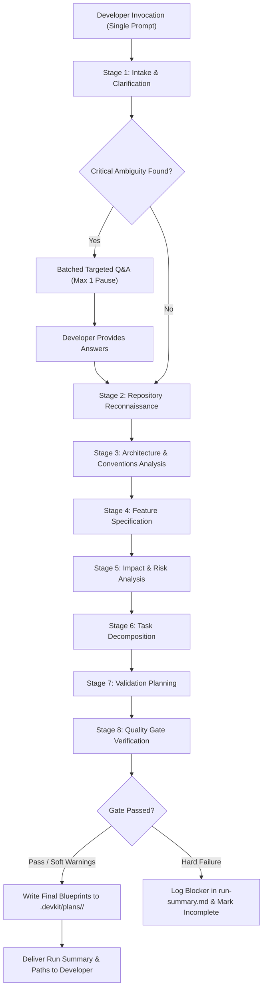

# Agentic Feature Planning DevKit — Functional Specification

> **Version:** 0.2.0  
> **Status:** Approved for HLD  
> **Created:** 2026-11-03  
> **Last Updated:** 2026-11-04  
> **Authors:** Antigravity AI + Project Owner  

---

## Revision History

| Version | Date | Author | Changes |
|---------|------|--------|---------|
| 0.1.0-draft | 2026-11-03 | Antigravity AI | Initial draft specification. |
| 0.2.0 | 2026-11-04 | Project Owner + Antigravity AI | Mandated harness-agnostic MVP with thin adapter pattern; resolved all 5 open architectural decisions (pure instruction-based core, single-agent automatic orchestration, hybrid intermediate state, slug-based feature IDs, evidence rubric replacing 70% confidence threshold); added repository type detection; shifted to evidence-driven framework detection; updated artifact storage path to `.devkit/plans/<feature-slug>/`; added explicit acceptance criteria; removed contradictory assumptions and deferred classifications. |

---

## Table of Contents

1. [Overview](#1-overview)
2. [Goals and Non-Goals](#2-goals-and-non-goals)
3. [Finalized Architectural Decisions](#3-finalized-architectural-decisions)
4. [Developer Experience Definition](#4-developer-experience-definition)
5. [Acceptance Criteria](#5-acceptance-criteria)
6. [Functional Requirements](#6-functional-requirements)
7. [Non-Functional Requirements](#7-non-functional-requirements)
8. [DevKit Contract — Inputs and Outputs](#8-devkit-contract--inputs-and-outputs)
9. [Planning Stages and Responsibilities](#9-planning-stages-and-responsibilities)
10. [Intermediate State and Session Independence](#10-intermediate-state-and-session-independence)
11. [Blueprint Artifact Format](#11-blueprint-artifact-format)
12. [Repository Intelligence and Type Detection](#12-repository-intelligence-and-type-detection)
13. [Framework Standards and Convention Handling](#13-framework-standards-and-convention-handling)
14. [Human Intervention Rules](#14-human-intervention-rules)
15. [Plan Quality Gate](#15-plan-quality-gate)
16. [Harness Architecture and Adapter Contract](#16-harness-architecture-and-adapter-contract)
17. [MVP Scope vs. Future Capabilities](#17-mvp-scope-vs-future-capabilities)
18. [Assumptions](#18-assumptions)
19. [Risks and Mitigations](#19-risks-and-mitigations)
20. [Glossary](#20-glossary)

---

## 1. Overview

### 1.1 Problem Statement

Software teams frequently lose time translating feature requirements into an actionable implementation plan that is:
- Grounded in the actual codebase (rather than generic advice),
- Detailed enough for a second developer or agentic harness to execute without requiring the original conversational context,
- Consistent with existing architecture, conventions, and dependencies.

Standard conversational AI sessions produce ephemeral plans that vanish when sessions end. Developers must rebuild context manually, and AI tools without structured repository reconnaissance generate generic, inaccurate plans with fabricated file paths and mismatched conventions.

### 1.2 Solution

The **Agentic Feature Planning DevKit** (DevKit) is a reusable, plug-and-play developer productivity framework that:
- Accepts a target repository, a feature/problem statement, and an optional technology stack hint.
- Autonomously executes a structured, multi-stage planning pipeline in a single invocation.
- Produces a suite of persistent, portable, Markdown-based planning artifacts (the **Blueprint**) stored inside `.devkit/plans/<feature-slug>/` within the target repository.
- Operates on a harness-agnostic core using standard Markdown instructions and schemas, with thin adapters for specific agent runtimes (Antigravity for MVP).

### 1.3 Scope of this Document

This specification defines the functional behavior, developer experience, finalized architectural decisions, artifact contracts, planning stage workflows, intermediate state management, quality gates, and MVP boundaries. 

It explicitly separates planning from implementation: the DevKit never modifies application source code during planning. Execution of code changes and validation test suites are future capabilities.

---

## 2. Goals and Non-Goals

### 2.1 Goals

| # | Goal |
|---|------|
| G1 | Accept any repository (local path or remote Git URL) and plain-English feature statement to generate an actionable, repository-aware plan. |
| G2 | Produce session-independent, portable Markdown artifacts readable and executable by any developer or agent without prior conversational history. |
| G3 | Execute all planning stages automatically in a single invocation, with at most one batched clarifying Q&A pause if critical ambiguity arises. |
| G4 | Maintain a harness-agnostic core planning workflow that is completely independent of Antigravity or any proprietary agent runtime. |
| G5 | Provide a thin Antigravity adapter for the MVP while defining a clear adapter contract for future harnesses. |
| G6 | Strictly isolate planning from implementation; zero modifications to application source code during a planning run. |
| G7 | Base all architectural and framework inferences on concrete repository evidence; never fabricate paths, dependencies, or conventions. |
| G8 | Provide adaptive planning depth based on feature scope and codebase complexity. |
| G9 | Store all planning artifacts in a standardized repository path (`.devkit/plans/<feature-slug>/`) for team discovery and version control. |

### 2.2 Non-Goals (MVP)

| # | Non-Goal |
|---|----------|
| NG1 | Implementation execution — writing, editing, or deleting application source code. |
| NG2 | Test execution — running test suites or CI checks against generated code. |
| NG3 | Multi-agent orchestration — subagent swarms or distributed agent coordination (single-agent execution for MVP). |
| NG4 | Standalone CLI binary — distributing an external binary executable (pure instruction/adapter-based for MVP). |
| NG5 | Multi-repository planning — coordinating changes across multiple independent git repositories. |
| NG6 | Mandatory external tracker integrations — hard requirements on Jira, Linear, or GitHub Issues. |
| NG7 | Interactive graphical UI or web editor. |

---

## 3. Finalized Architectural Decisions

### AD-1: Invocation Model & Harness Independence (Resolved ARCH-OQ-1)

- **Decision:** **Option A — Pure instruction-based core for MVP.**
- **Details:** The core DevKit consists of portable, structured Markdown planning instructions, schemas, and rubrics. It requires no standalone CLI binary or compiled runtime. The executing agent interprets these instructions using standard file read/write and reasoning capabilities provided by the host harness.
- **Harness Separation:** The core planning workflow contains zero references to Antigravity-specific tools, syntax, or commands. A thin adapter packages these instructions for Antigravity.
- **Limitations & Future Extensions:** In the absence of a dedicated CLI, file discovery relies on agent-executed shell or file tools. For harnesses lacking autonomous file tools, an optional CLI wrapper can be introduced in post-MVP releases as a non-breaking extension.

### AD-2: Stage Orchestration (Resolved ARCH-OQ-2)

- **Decision:** **Option A — Single-agent autonomous planning for MVP.**
- **Details:** All planning stages execute sequentially and automatically within a single agent invocation. The developer triggers the workflow once; the agent advances through all stages without manual prompting.
- **Decoupling for Multi-Agent Future:** Every stage maintains a strict contract: explicit input reads and structured intermediate summary writes. This clean boundary allows migrating individual stages to isolated subagents in future versions without rewriting stage logic.

### AD-3: Intermediate State Management (Resolved ARCH-OQ-3)

- **Decision:** **Option C — Hybrid intermediate persistence.**
- **Details:** The agent maintains reasoning context in-memory while persisting lightweight, structured Markdown summaries to `.devkit/run-state/` after each stage.
- **Purpose & Lifecycle:** Provides execution observability, debugging audit trails, and clean recovery handoffs for fresh agent sessions if interrupted. Run-state files are temporary; upon successful plan approval, key summaries are consolidated into `plan-run.log` and the temporary run-state can be archived or purged.

### AD-4: Feature ID & Artifact Storage (Resolved ARCH-OQ-4)

- **Decision:** **Human-readable feature slug with collision detection.**
- **Details:** The DevKit derives a URL-safe slug from the feature statement (e.g., `add-oauth2-google-login`). If `.devkit/plans/<feature-slug>/` exists, it appends an incremental suffix (`-2`, `-3`).
- **Location:** All artifacts are stored in `.devkit/plans/<feature-slug>/`. A lightweight registry/index (`.devkit/plans/index.md`) is optional and updated if present, ensuring multi-developer discovery across git branches.

### AD-5: Assumption & Decision Rubric (Resolved ARCH-OQ-5)

- **Decision:** **Evidence-based decision rubric (Numeric confidence thresholds removed).**
- **Details:** The agent must never claim arbitrary percentage confidence scores (e.g., "70% confident"). Decisions must be categorized strictly according to demonstrable evidence:
  1. *Evidence-Supported:* Direct proof in repository code, configs, manifests, or tests.
  2. *Reasonable Assumption:* Safe, industry-standard convention where code is silent, with low blast radius.
  3. *Design Choice:* Meaningful architectural branch with trade-offs; documented with rationale and alternatives.
  4. *Critical Ambiguity:* Fundamental requirement contradiction or void that prevents deterministic planning; triggers the single developer Q&A pause.

---

## 4. Developer Experience Definition

### 4.1 Invocation Experience

A developer triggers feature planning with a single command or instruction in their agent environment.

**Conceptual Input Contract:**
```
devkit plan \
  --repo <path-or-url> \
  --feature "<feature / problem statement>" \
  [--stack "<optional stack hint>"] \
  [--depth auto|shallow|deep] \
  [--feature-id "<optional-slug-override>"]
```

**Antigravity Adapter Invocation (MVP):**
The developer invokes the planning skill in Antigravity:
```
Plan feature: "Add user profile avatar upload with S3 storage"
Repo: /path/to/repo (or active workspace)
```

### 4.2 End-to-End Workflow Flowchart



### 4.3 Key UX Tenets
- **Zero Step-by-Step Prompting:** The developer does not prompt the agent to proceed to subsequent stages.
- **Batched Interruption Only:** If clarifying questions are mandatory, they are presented all at once after Stage 1. No continuous conversational interruptions.
- **Clean Workspace:** Application source code is never touched.

---

## 5. Acceptance Criteria

The following verifiable criteria determine DevKit compliance:

- [ ] **AC-1 (Harness Independence):** The core planning workflow instructions contain no Antigravity-specific syntax or tool names. The core can be executed in another LLM harness supporting file tools by following the same Markdown instructions.
- [ ] **AC-2 (Fresh-Session Reusability):** An independent developer or agent session, given only `.devkit/plans/<feature-slug>/` and the repository, can execute tasks without access to the planning conversation.
- [ ] **AC-3 (No Conversation History Dependency):** If an agent session is terminated after Stage 3, a new agent session reading `.devkit/run-state/` can resume Stage 4 without loss of context.
- [ ] **AC-4 (Zero Source Code Mutation):** A complete planning run results in zero git status changes outside `.devkit/`. No application code, configs, or tests are created or modified.
- [ ] **AC-5 (Evidence-Grounded Paths):** 100% of file paths referenced in `task-breakdown.md` and `implementation-plan.md` either exist currently in the repository or are explicitly tagged `[NEW FILE]`.
- [ ] **AC-6 (Specification Traceability):** Every functional requirement in `feature-spec.md` maps directly to at least one task in `task-breakdown.md` and one test case in `validation-plan.md`.
- [ ] **AC-7 (Evidence-Driven Framework Handling):** Framework conventions are extracted from inspected files and manifests. If the repository violates canonical framework style, the plan follows the repository's convention.
- [ ] **AC-8 (Single-Agent Autonomous Execution):** The entire 8-stage pipeline runs to completion from a single developer trigger without requiring manual prompts between stages.
- [ ] **AC-9 (No CLI Prerequisite):** The DevKit operates entirely using the harness agent's built-in file and reasoning capabilities without requiring a pre-installed binary CLI.
- [ ] **AC-10 (Repository Type Awareness):** The plan explicitly records the detected repository type (Application, Library/SDK, Data Engineering, Infrastructure, Monorepo, or Unknown) in `run-summary.md`.

---

## 6. Functional Requirements

### 6.1 Intake & Repository Validation
- **FR-1.1:** Accept a local filesystem directory or remote Git URL.
- **FR-1.2:** Accept a plain-language feature/problem statement.
- **FR-1.3:** Accept an optional tech stack hint to guide reconnaissance without overriding observed facts.
- **FR-1.4:** Verify repository read permissions before commencing analysis.
- **FR-1.5:** Generate a URL-safe, collision-resistant feature slug per AD-4.

### 6.2 Repository Reconnaissance & Type Detection
- **FR-2.1:** Detect primary programming languages, build tooling, package managers, and lockfiles.
- **FR-2.2:** Classify repository type (Application, Library, Data Engineering, Infrastructure, Monorepo, or Unknown) per Section 12.
- **FR-2.3:** Map directory hierarchy, primary entry points, configuration profiles, and schemas.
- **FR-2.4:** Identify existing testing frameworks, directories, fixtures, and coverage tools.
- **FR-2.5:** Identify linting, formatting, and static analysis configurations.
- **FR-2.6:** Strictly disallow path fabrication. Every referenced path must be verified against disk.

### 6.3 Architecture & Convention Analysis
- **FR-3.1:** Infer architectural patterns (MVC, Clean/Hexagonal, Event-Driven, Microservice, Monolith) from code layout and dependencies, tagging inferences as `[INFERRED]`.
- **FR-3.2:** Extract existing code conventions: naming cases, file placement, import structures, error response formats, logging patterns, and test assertion styles.
- **FR-3.3:** Locate shared utilities, base classes, domain entities, and database migration mechanisms relevant to the feature.

### 6.4 Feature Specification & Traceability
- **FR-4.1:** Formulate user stories, functional requirements, and non-functional requirements.
- **FR-4.2:** Specify verifiable, binary-pass acceptance criteria for every requirement.
- **FR-4.3:** Clearly delineate in-scope boundaries from out-of-scope items.
- **FR-4.4:** Document assumptions according to the Evidence Rubric (Section 14).
- **FR-4.5:** Record open architectural or product questions as `[OPEN]` with suggested resolution paths.

### 6.5 Impact, Risk, and Task Decomposition
- **FR-5.1:** Produce a comprehensive list of files to modify and files to create.
- **FR-5.2:** Enumerate technical, regression, security, and performance risks with concrete mitigations.
- **FR-5.3:** Decompose the feature into sequential, dependency-ordered tasks grouped into logical phases.
- **FR-5.4:** Provide self-contained task instructions: specific file paths, code changes, and task-level acceptance criteria.
- **FR-5.5:** Ensure tasks form a directed acyclic graph (DAG) with zero circular dependencies.

### 6.6 Validation Planning
- **FR-6.1:** Map every acceptance criterion to explicit unit, integration, or end-to-end test cases.
- **FR-6.2:** Align test recommendations with the repository's existing test libraries and runners.
- **FR-6.3:** Detail test data fixtures, mocks, and environment variables needed.
- **FR-6.4:** Define step-by-step manual verification procedures for non-automatable criteria.

### 6.7 Quality Gate & Blueprint Output
- **FR-7.1:** Execute Stage 8 quality checks (hard gates and soft gates).
- **FR-7.2:** Write the complete Blueprint artifact suite to `.devkit/plans/<feature-slug>/`.
- **FR-7.3:** Generate `run-summary.md` and `plan-run.log`.
- **FR-7.4:** Ensure zero file writes occur outside `.devkit/`.

---

## 7. Non-Functional Requirements

- **NFR-1 (Factual Accuracy):** 100% of asserted repository facts (files, libraries, versions) must reflect actual disk contents.
- **NFR-2 (Portability):** Artifacts must be valid GitHub-Flavored Markdown rendering cleanly without proprietary viewers.
- **NFR-3 (Harness Independence):** Core planning prompt logic must execute across any capable LLM harness.
- **NFR-4 (Zero Blast Radius):** Running the planner must leave the target repository's application code untouched.
- **NFR-5 (Resilience & Recovery):** Intermediate state in `.devkit/run-state/` must allow a fresh session to recover from interruption.
- **NFR-6 (Auditability):** All decisions, assumptions, and quality gate evaluations must be explicitly logged.

---

## 8. DevKit Contract — Inputs and Outputs

### 8.1 Input Parameters

| Parameter | Type | Required | Description |
|-----------|------|----------|-------------|
| `repo` | String | Yes | Path to local repository root or remote Git URL. |
| `feature` | String | Yes | Natural language feature request or problem statement. |
| `stack` | String | No | Advisory hint on framework/stack (used to focus reconnaissance). |
| `depth` | Enum | No | `auto` (default), `shallow` (fast/small scope), `deep` (high-risk/large scope). |
| `feature_id` | String | No | Custom slug override. If omitted, derived automatically. |

### 8.2 Blueprint Output Suite (`.devkit/plans/<feature-slug>/`)

| File | Primary Role |
|------|--------------|
| `feature-spec.md` | Authoritative requirements, user stories, acceptance criteria, boundaries. |
| `implementation-plan.md` | Architectural strategy, impact analysis, risk register, DoD. |
| `task-breakdown.md` | Dependency-ordered, file-targeted task list with Mermaid DAG. |
| `validation-plan.md` | Unit/integration/e2e test specifications linked to acceptance criteria. |
| `decisions.md` | Architecture Decision Records (ADRs), open questions, assumptions. |
| `run-summary.md` | Developer entry point, quality gate results, execution summary. |
| `plan-run.log` | Chronological execution log, stage durations, and anomalies. |

---

## 9. Planning Stages and Responsibilities

The pipeline executes through 8 consecutive stages in a single agent session:

```
[Stage 1: Intake & Clarification]
       │
[Stage 2: Repository Reconnaissance]
       │
[Stage 3: Architecture & Conventions]
       │
[Stage 4: Feature Specification]
       │
[Stage 5: Impact & Risk Analysis]
       │
[Stage 6: Task Decomposition]
       │
[Stage 7: Validation Planning]
       │
[Stage 8: Quality Gate Verification]
```

### Stage 1: Intake & Clarification
- Parses feature statement, validates repo access, determines depth, generates slug.
- Evaluates ambiguities against the Evidence Rubric. If a **Critical Ambiguity** exists, halts once, asks batched questions, and resumes upon receipt of developer input.
- *Output:* `.devkit/run-state/intake.md`

### Stage 2: Repository Reconnaissance
- Inspects manifests, directory trees, lockfiles, tools, and tests.
- Detects repository type and catalogs existing technical capabilities.
- *Output:* `.devkit/run-state/repo-map.md`, `.devkit/run-state/repo-type.md`

### Stage 3: Architecture & Conventions Analysis
- Maps module boundaries, data flows, persistence models, and API interfaces.
- Extracts empirical conventions (naming, error handling, logging, testing patterns).
- *Output:* `.devkit/run-state/architecture.md`, `.devkit/run-state/conventions.md`

### Stage 4: Feature Specification
- Synthesizes user stories, functional requirements, and strict acceptance criteria.
- Formulates initial draft of `feature-spec.md`.

### Stage 5: Impact & Risk Analysis
- Analyzes blast radius, affected modules, backward compatibility, and security.
- Populates risk register and implementation approach in `implementation-plan.md`.

### Stage 6: Task Decomposition
- Breaks feature into phased, dependency-sequenced, atomic tasks.
- Produces `task-breakdown.md` with file targets (`existing` or `[NEW FILE]`).

### Stage 7: Validation Planning
- Drafts test cases covering all acceptance criteria, identifying fixture and mock needs.
- Produces `validation-plan.md`.

### Stage 8: Quality Gate Verification
- Runs traceability, path verification, and DAG checks.
- Writes `decisions.md`, `run-summary.md`, and `plan-run.log`.
- Promotes plan status to `approved` or flags `draft`/`incomplete`.

---

## 10. Intermediate State and Session Independence

### 10.1 Persisted Intermediate Artifacts

Stored in `.devkit/run-state/`:

| Artifact | Purpose | Lifecycle |
|----------|---------|-----------|
| `intake.md` | Records parsed goals, scope, and clarification answers. | Temporary (cleared on completion or archived). |
| `repo-map.md` | Inventory of files, frameworks, dependencies, tools. | Temporary. |
| `repo-type.md` | Classification of repository with supporting signals. | Temporary. |
| `architecture.md` | Inferred architectural patterns and module boundaries. | Temporary. |
| `conventions.md` | Extracted naming, coding, and structural conventions. | Temporary. |
| `stage-log.md` | Running stage execution audit trail. | Becomes `plan-run.log`. |

### 10.2 Fresh-Session Handoff & Recovery

- If a session terminates unexpectedly (e.g., context exhaustion, timeout):
  1. A new agent session reads `.devkit/run-state/stage-log.md`.
  2. The agent identifies the last successfully completed stage.
  3. The agent loads the structured summaries from `.devkit/run-state/`.
  4. The pipeline resumes from the subsequent stage without repeating earlier analysis or requiring conversational history.

### 10.3 Target Repository Isolation
- `.devkit/run-state/` should be included in `.gitignore`.
- Blueprint outputs in `.devkit/plans/<feature-slug>/` are committed to version control.

---

## 11. Blueprint Artifact Format

Every artifact begins with standard YAML front-matter:

```yaml
---
devkit_version: "0.2.0"
artifact_type: "<feature-spec|implementation-plan|task-breakdown|validation-plan|decisions>"
feature_id: "<feature-slug>"
feature_name: "<Human Readable Name>"
repo: "<repo-identifier>"
generated_at: "<ISO-8601-Timestamp>"
planning_depth: "<auto|shallow|deep>"
status: "<approved|draft|incomplete>"
schema_version: "1"
---
```

### Artifact Structure Overview

- **`feature-spec.md`:** Executive Summary, User Stories, Functional Requirements (FR-xx) with Acceptance Criteria (AC-xx), Non-Functional Requirements, In-Scope/Out-of-Scope boundaries.
- **`implementation-plan.md`:** Repository Context, Inferred Architecture, Implementation Approach Narrative, Impact Analysis (Files to Modify, Files to Create), Risk Register, Definition of Done.
- **`task-breakdown.md`:** Phase breakdown, Task Cards (ID, Type, Complexity, Requirement Link, Dependencies, Files, Instructions, Verification), Mermaid Flowchart DAG.
- **`validation-plan.md`:** Test Strategy, Detailed Test Cases (TC-xx) mapped to AC-xx, Existing Test Modifications, Fixture/Mock Requirements, Manual Verification Protocol.
- **`decisions.md`:** Architectural Decision Records (ADRs with Context, Decision, Consequences), Open Questions (`[OPEN]`), Documented Assumptions (`[ASSUMPTION: <level>]`).
- **`run-summary.md`:** Executive Run Metadata, Quality Gate Verification Matrix, Key Decisions, Next Steps.

---

## 12. Repository Intelligence and Type Detection

### 12.1 Repository Classification Matrix

The DevKit classifies the repository into one of the following archetypes:

| Archetype | Key Identification Signals | Planning Adaptation |
|-----------|----------------------------|---------------------|
| **Application** | Web frameworks, HTTP routes, UI components, server entrypoints, container definitions. | Focuses on user-facing behaviors, APIs, state management, and database migrations. |
| **Library / SDK** | Public API exports, packaging configs, semver tags, high unit test density, lack of server runtime. | Focuses on API backwards-compatibility, minimal dependencies, and public documentation. |
| **Data Engineering** | Pipelines, ETL scripts, DAG definitions (Airflow, dbt), Spark/Kafka configs, schema registries. | Focuses on data integrity, idempotent migrations, schema evolution, and pipeline performance. |
| **Infrastructure / DevOps** | Terraform, Helm, Kubernetes manifests, Ansible, cloud formation templates. | Focuses on resource idempotency, security blast radius, state management, and rollback plans. |
| **Monorepo** | Multi-package workspace configs (`pnpm-workspace.yaml`, `lerna.json`, `nx.json`, Cargo workspaces). | Isolates impact to specific package boundaries and evaluates cross-package dependencies. |
| **Unknown / Mixed** | Hybrid or non-standard code structures that evade standard classification. | Documents limitations in `run-summary.md` and uses empirical code-level convention extraction. |

### 12.2 Evidence Priority Hierarchy

When resolving conflicts or uncertain signals:
```
1. Actual Implementation Code (Ground Truth)
   └─► 2. Repository Configuration & Manifests
         └─► 3. In-Repo Documentation & Tests
               └─► 4. General Framework Conventions (Advisory Only)
```

---

## 13. Framework Standards and Convention Handling

### 13.1 Evidence-Driven Framework Handling

- The DevKit avoids hardcoded assumptions about specific frameworks.
- Framework detection is purely evidence-driven:
  1. Manifest dependencies (e.g., `react`, `django`, `actix-web`).
  2. Configuration files (e.g., `tsconfig.json`, `vite.config.ts`, `settings.py`).
  3. Structural patterns (e.g., `controllers/`, `views/`, `routes/`).
- General framework best practices serve only as hypotheses; observed repository patterns always prevail.

### 13.2 Convention Precedence Rule

> **The Repository Overrides the World:**  
> If a detected framework recommends kebab-case file naming, but the repository consistently uses PascalCase, the DevKit **must** adopt PascalCase. The deviation is logged as an `[ASSUMPTION: evidence-supported]`.

---

## 14. Human Intervention Rules

### 14.1 Evidence-Based Decision Rubric

| Level | Definition | Action Required |
|-------|------------|-----------------|
| **1. Evidence-Supported** | Decision is corroborated by existing repository code, configs, or conventions. | Adopt immediately. Document as `[ASSUMPTION: evidence-supported]`. |
| **2. Reasonable Assumption** | Codebase is silent, but standard industry convention provides a low-risk default. | Adopt default. Document as `[ASSUMPTION: reasonable-default]`. |
| **3. Design Choice** | Multiple valid technical approaches exist with distinct trade-offs; choice is non-blocking. | Select most conservative path. Document ADR and alternatives in `decisions.md`. |
| **4. Critical Ambiguity** | Scope is fundamentally contradictory or missing core business logic that prevents planning. | **Pause.** Present batched question to developer. |

### 14.2 Interruption Constraints
- Maximum of **one** batched Q&A pause per planning run (occurring immediately after Stage 1).
- Maximum of **5** questions per pause.
- Questions must include context, options, and recommended default.
- If unanswered, the DevKit selects the safest default and proceeds, logging the decision in `decisions.md`.

---

## 15. Plan Quality Gate

Stage 8 verifies plan integrity before finalizing artifacts.

### 15.1 Hard Gates (Failure marks plan `incomplete`)
- **QG-H1 (Zero Path Hallucination):** Every file path in `task-breakdown.md` exists or is tagged `[NEW FILE]`.
- **QG-H2 (Acyclic Task DAG):** The task dependency graph contains zero circular references.
- **QG-H3 (Requirement Coverage):** Every functional requirement (FR-xx) maps to at least one task.
- **QG-H4 (Acceptance Criteria Coverage):** Every acceptance criterion (AC-xx) maps to at least one test case.
- **QG-H5 (Source Code Non-Mutation):** No application source code was modified during planning.

### 15.2 Soft Gates (Failure marks plan `draft`)
- **QG-S1:** All open questions (`[OPEN]`) have suggested resolution options.
- **QG-S2:** Every task includes an estimated complexity rating (S/M/L/XL).
- **QG-S3:** Risk register contains at least one technical risk and mitigation.
- **QG-S4:** Repository type and confidence rationales are documented in `run-summary.md`.

---

## 16. Harness Architecture and Adapter Contract

### 16.1 Conceptual Layering

```
┌────────────────────────────────────────────────────────┐
│                   Harness Layer                        │
│   Antigravity Adapter    │    Future Adapters          │
│   (Skill Packaging,      │    (Cursor, Copilot,        │
│    Harness Invocation)   │     Claude Code)            │
├────────────────────────────────────────────────────────┤
│                 Adapter Contract                       │
│   Standard parameter mapping & I/O abstraction         │
├────────────────────────────────────────────────────────┤
│                 Core Planning Layer                    │
│   - Portable Markdown Instructions                     │
│   - 8-Stage Planning Engine                            │
│   - Evidence Rubric & Quality Gate Verification        │
│   - Blueprint Markdown Templates                       │
├────────────────────────────────────────────────────────┤
│                 Target Repository                      │
│   - Read-only codebase inspection                      │
│   - Output: .devkit/plans/<slug>/                      │
└────────────────────────────────────────────────────────┘
```

### 16.2 Core vs. Adapter Separation

- **Core Layer:** Pure, harness-agnostic planning instructions, validation rules, rubrics, and artifact schemas. Contains zero harness-specific tool references or syntax.
- **Adapter Layer:** Maps harness-specific invocation methods (skills, slash commands, agent prompts) into the DevKit core parameters, grants file access tools, and presents the output summary to the developer.

### 16.3 Adapter Contract Specifications

Any harness adapter must satisfy three capabilities:
1. **Invocation Mapping:** Collect `repo`, `feature`, and optional parameters, and invoke the core instructions.
2. **File Tooling:** Provide read access to the target repository and write access to `.devkit/`.
3. **Clarification Relay:** If Stage 1 detects a Critical Ambiguity, pause to present questions to the user and resume upon answer.

### 16.4 Antigravity Adapter (MVP Implementation)
- Implemented as a reusable Antigravity skill.
- Packages the core planning instructions.
- Utilizes standard Antigravity file reading and writing tools.
- Executes within the active Antigravity session without external binary dependencies.

---

## 17. MVP Scope vs. Future Capabilities

| Capability Area | MVP (v0.2.0) | Post-MVP / Future |
|-----------------|--------------|-------------------|
| **Core Workflow** | Harness-agnostic Markdown planning engine. | Additional harness adapters (Cursor, Claude Code, Copilot). |
| **Orchestration** | Single-agent automatic execution. | Multi-agent stage delegation (specialized subagents). |
| **Execution Tooling** | Instruction & adapter-based (no CLI). | Optional standalone CLI wrapper. |
| **Repository Scope** | Single repository (Local or Remote Git). | Multi-repository and distributed microservice planning. |
| **Repository Types** | Apps, Libraries, Data Eng, Infra, Monorepos. | Domain-specific deep analyzers (e.g., embedded firmware). |
| **Phase Lifecycle** | Planning only (zero code mutation). | Automated implementation execution and test validation. |
| **Integrations** | Local file artifacts (`.devkit/plans/`). | Bi-directional Jira, Linear, and GitHub Issues sync. |
| **Plan Maintenance** | Fresh plan generation. | Incremental re-planning on modified repositories. |

---

## 18. Assumptions

| ID | Assumption | Level | Basis | Risk if Wrong |
|----|-----------|-------|-------|---------------|
| AS-1 | The executing agent has filesystem read access to the target codebase. | Evidence-Supported | Core requirement for reconnaissance. | DevKit fails immediately with access error. |
| AS-2 | Plans are written in English. | Reasonable Assumption | Default industry lingua franca. | Internationalization needed in future versions. |
| AS-3 | Planning runs target a single feature or discrete architectural change. | Reasonable Assumption | Complex multi-month initiatives exceed single-plan scope. | User must decompose multi-feature epics before planning. |
| AS-4 | Dependency manifests are legible text files. | Evidence-Supported | Modern build systems use text manifests. | Binary dependency catalogs cannot be parsed. |
| AS-5 | Target repository permits storing planning artifacts under `.devkit/`. | Reasonable Assumption | Standard practice for developer tooling. | Can be overridden via output configuration if restricted. |

---

## 19. Risks and Mitigations

| Risk | Impact | Likelihood | Mitigation Strategy |
|------|--------|------------|---------------------|
| Inferred architecture is inaccurate for idiosyncratic repos. | High | Medium | Label all inferences `[INFERRED]`; check against code evidence; reviewable in `decisions.md`. |
| Feature request is critically ambiguous. | High | Medium | Stage 1 batched Q&A pause; explicit `[OPEN]` items in plan. |
| LLM context window overflows on large repos. | Medium | Medium | Reconnaissance scan limits (Stage 2 prioritized filtering); compact intermediate summaries. |
| Planning artifacts become stale over time. | Medium | High | Explicit `generated_at` metadata; plan includes checksum of examined HEAD commit. |
| Harness leakage into core instructions. | High | Low | Strict adapter contract isolation; linting of core instruction Markdown files. |

---

## 20. Glossary

- **Blueprint:** The complete set of 7 Markdown planning documents generated in `.devkit/plans/<feature-slug>/`.
- **Critical Ambiguity:** A missing requirement or contradictory scope that completely blocks deterministic planning.
- **Evidence Rubric:** 4-tier decision framework (Evidence-Supported, Reasonable Assumption, Design Choice, Critical Ambiguity) replacing arbitrary numeric confidence metrics.
- **Harness:** The host agentic runtime (e.g., Antigravity) providing LLM execution and tool access.
- **Plan Quality Gate:** Stage 8 automated verification rules checking traceability, path existence, and DAG validity.
- **Repository Reconnaissance:** Deep, read-only inspection of repository structure, manifests, and conventions in Stage 2.
- **Run-State:** Structured, temporary Markdown files persisted in `.devkit/run-state/` for observability and session handoff.
- **Task DAG:** Directed Acyclic Graph representing implementation tasks and their prerequisite relationships.

---
*End of Functional Specification — v0.2.0*
